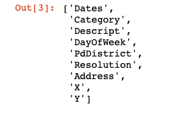
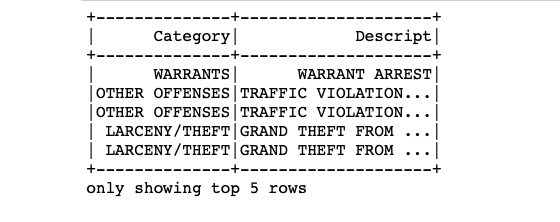
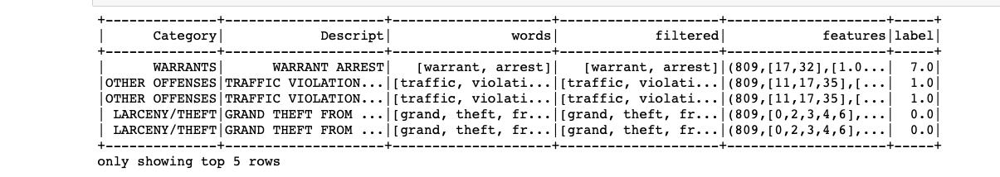

# BÁO CÁO CHẠY CODE CHƯƠNG 11
## Phân loại tội phạm San Francisco bằng PySpark
### (Detecting crime using San Francisco crime data)

| | |
|---|---|
| **Sách** | *Hands-On Artificial Intelligence for IoT* – Amita Kapoor, Packt Publishing, 2019 |
| **Mục trong sách** | Chương 11, "Detecting crime using San Francisco crime data", trang 332–336 bản in (trang 345–349 PDF) |
| **Code gốc** | `Chapter11/SF_crime_category_detection.ipynb` (notebook đi kèm sách) |
| **Kết quả chạy** | `Chapter11/SF_crime_category_detection_spark4.ipynb` |
| **Nhóm thực hiện** | *(điền tên nhóm và thành viên)* |
| **Báo cáo liên quan** | [Báo cáo nội dung Chương 11](Bao_cao_noi_dung_Chuong_11.md) |

---

## Tóm tắt kết quả

- **Code của sách chạy được trên máy của nhóm mà không phải sửa dòng nào** (Cách 2: Python 3.12, PySpark 4.2.0, Java 21). Toàn bộ notebook chạy hết trong khoảng **30 giây**.
- **Mọi bước xử lý dữ liệu cho kết quả giống notebook gốc từng ký tự.** Chỉ bước chia dữ liệu ngẫu nhiên và các bước sau đó lệch rất nhỏ: chỉ số đánh giá ra **0,97262** so với **0,97253** trong sách.
- **Tái hiện tuyệt đối đã được kiểm chứng** (Cách 1): dùng đúng phiên bản cũ (Spark 2.4.0, Java 8, Python 3.7) và giới hạn Spark ở 8 luồng CPU thì kết quả **trùng notebook gốc đến chữ số thập phân thứ 16**.
- **Con số "97% accuracy" trong sách thực chất là chỉ số F1.** Accuracy thực tế là **97,8%**.
- **Phân tích thêm của nhóm:**
  - 6 trong 39 loại tội phạm không bao giờ được mô hình dự đoán.
  - Bài toán gần như chỉ là tra bảng: mỗi mô tả gần như ứng với đúng một loại tội phạm.
  - Chỉ cần giảm tham số điều chuẩn là accuracy tăng lên **99,7%**.

---

## Mục lục

1. [Mục tiêu](#1-mục-tiêu)
2. [Bài toán và dữ liệu](#2-bài-toán-và-dữ-liệu)
3. [Môi trường thực nghiệm](#3-môi-trường-thực-nghiệm)
4. [Quy trình code](#4-quy-trình-code)
5. [Kết quả chạy](#5-kết-quả-chạy)
6. [Kiểm chứng tái hiện tuyệt đối và nguyên nhân sai khác](#6-kiểm-chứng-tái-hiện-tuyệt-đối-và-nguyên-nhân-sai-khác)
7. [Phân tích sâu kết quả](#7-phân-tích-sâu-kết-quả)
8. [Sự cố gặp phải và cách xử lý](#8-sự-cố-gặp-phải-và-cách-xử-lý)
9. [Khác biệt giữa code in trong sách và notebook](#9-khác-biệt-giữa-code-in-trong-sách-và-notebook)
10. [Kết luận](#10-kết-luận)
11. [Hướng phát triển](#11-hướng-phát-triển)
12. [Phụ lục](#12-phụ-lục)

---

## 1. Mục tiêu

1. Cài đặt môi trường và chạy lại ví dụ code duy nhất của Chương 11 trên máy của nhóm.
2. Đối chiếu từng kết quả với notebook gốc của tác giả để đánh giá mức độ tái hiện.
3. Giải thích nguyên nhân của mọi sai khác.
4. Phân tích sâu hơn chất lượng mô hình, làm cơ sở cho phần phát triển ứng dụng và demo phần cứng.

---

## 2. Bài toán và dữ liệu

### 2.1. Bài toán

Dự đoán **loại tội phạm** (`Category`) từ **đoạn mô tả vụ việc** (`Descript`) do cảnh sát San Francisco ghi lại. Đây là bài toán **phân loại văn bản đa lớp** với 39 lớp.

### 2.2. Nguồn dữ liệu

Nhóm dùng bộ dữ liệu cuộc thi Kaggle *San Francisco Crime Classification*, có nguồn gốc từ cổng dữ liệu mở DataSF mà sách nhắc tới. Bộ dữ liệu gồm 3 file:

| File | Kích thước | Số dòng | Dùng trong bài? |
|---|---|---|---|
| `train.csv` | 127,4 MB | 878.049 | **Có** – đây là dữ liệu notebook cần, nhưng notebook đọc tên `sf_crime_dataset.csv` |
| `test.csv` | 91,0 MB | 884.262 | Không – file này không có cột `Category` và `Descript` |
| `sampleSubmission.csv` | 75,1 MB | – | Không – là mẫu file nộp bài của Kaggle |

Nhóm xác nhận `train.csv` đúng là dữ liệu tác giả dùng: số dòng (614.666 + 263.383 = 878.049), số cột, số loại tội phạm và thống kê từng loại đều trùng với notebook gốc.

### 2.3. Cấu trúc dữ liệu

| Cột | Ý nghĩa | Dùng trong mô hình? |
|---|---|---|
| `Dates` | Thời điểm xảy ra vụ việc | Không |
| `Category` | **Loại tội phạm** (nhãn cần dự đoán) | **Nhãn** |
| `Descript` | **Mô tả chi tiết vụ việc** | **Đầu vào** |
| `DayOfWeek` | Thứ trong tuần | Không |
| `PdDistrict` | Quận cảnh sát phụ trách | Không |
| `Resolution` | Cách giải quyết (ví dụ `ARREST, BOOKED`, `NONE`) | Không |
| `Address` | Địa chỉ gần đúng | Không |
| `X`, `Y` | Kinh độ, vĩ độ | Không |

### 2.4. Thống kê

| Chỉ tiêu | Giá trị |
|---|---|
| Tổng số bản ghi | 878.049 |
| Khoảng thời gian | 06/01/2003 00:01 → 13/05/2015 23:53 |
| Số loại tội phạm (`Category`) | 39 |
| Số mô tả khác nhau (`Descript`) | 879 |
| Kích thước từ vựng sau xử lý | 809 từ |

Dữ liệu **mất cân bằng mạnh**. 10 loại phổ biến nhất:

| # | Loại tội phạm | Số vụ | Tỷ lệ |
|---|---|---|---|
| 1 | LARCENY/THEFT (trộm cắp tài sản) | 174.900 | 19,9% |
| 2 | OTHER OFFENSES (vi phạm khác) | 126.182 | 14,4% |
| 3 | NON-CRIMINAL (không phạm tội) | 92.304 | 10,5% |
| 4 | ASSAULT (hành hung) | 76.876 | 8,8% |
| 5 | DRUG/NARCOTIC (ma túy) | 53.971 | 6,1% |
| 6 | VEHICLE THEFT (trộm xe) | 53.781 | 6,1% |
| 7 | VANDALISM (phá hoại tài sản) | 44.725 | 5,1% |
| 8 | WARRANTS (lệnh bắt) | 42.214 | 4,8% |
| 9 | BURGLARY (đột nhập) | 36.755 | 4,2% |
| 10 | SUSPICIOUS OCC (sự việc khả nghi) | 31.414 | 3,6% |

Ở đầu kia, các loại hiếm nhất chỉ có rất ít bản ghi: `TREA` có 6, `PORNOGRAPHY/OBSCENE MAT` có 22, `GAMBLING` có 146, `SEX OFFENSES NON FORCIBLE` có 148. Một mô hình luôn đoán "LARCENY/THEFT" sẽ đạt accuracy 19,9%; đây là **mức sàn** để so sánh.

---

## 3. Môi trường thực nghiệm

### 3.1. Phần cứng

| Thành phần | Thông số |
|---|---|
| CPU | AMD Ryzen 7 H 255 (8 nhân, 16 luồng) |
| RAM | 30,8 GB |
| Hệ điều hành | Windows 11 Home (bản 10.0.26300) |

### 3.2. So sánh môi trường

| | Tác giả (notebook gốc) | **Cách 1** – kiểm chứng tái hiện tuyệt đối | **Cách 2** – môi trường cài cố định |
|---|---|---|---|
| Python | 3.5.6 (ghi trong metadata notebook) | 3.7.9 | 3.12.10 |
| Spark / PySpark | 2.4 (suy luận, xem mục 6) | 2.4.0 | **4.2.0** |
| Java | 8 (yêu cầu của Spark 2.4) | OpenJDK 8u504 (Eclipse Temurin) | Oracle JDK 21.0.8 |
| numpy | – | 1.21.6 | 2.5.4 |
| Số luồng Spark dùng | 8 (suy luận, xem mục 6) | 8 (`local[8]`) | 16 (mặc định: toàn bộ CPU) |
| Cách chạy | Jupyter | Script Python chứa đúng code của notebook | Jupyter (nbconvert), notebook gốc không sửa |

**Lý do chọn Cách 2 làm môi trường chính:**

- Dùng phiên bản hiện hành và Java có sẵn trên máy.
- Không sửa code.
- Cách 1 cần Java 8 và Python 3.7, đều đã hết hạn hỗ trợ, nên chỉ dùng để kiểm chứng.

### 3.3. Cài đặt môi trường Cách 2

Yêu cầu có sẵn: Java 17 hoặc 21 trên `PATH` (máy nhóm có Java 21), và Python 3.12. Các lệnh chạy trong PowerShell:

```powershell
# 1. Tạo môi trường Python 3.12 riêng
py -3.12 -m venv $env:USERPROFILE\.venvs\spark-ch11
$py = "$env:USERPROFILE\.venvs\spark-ch11\Scripts\python.exe"

# 2. Cài thư viện (pyspark.ml bắt buộc có numpy)
& $py -m pip install pyspark==4.2.0 numpy ipykernel nbconvert

# 3. Đăng ký kernel để Jupyter / VS Code nhận ra môi trường
& $py -m ipykernel install --user --name spark-ch11 --display-name "Python 3.12 (Spark - Chuong 11)"

# 4. Đặt dữ liệu đúng tên notebook cần (chạy trong thư mục Chapter11)
Copy-Item train.csv sf_crime_dataset.csv

# 5. Chạy toàn bộ notebook gốc, lưu kết quả sang file mới (file gốc giữ nguyên)
& $py -m nbconvert --to notebook --execute --ExecutePreprocessor.kernel_name=spark-ch11 `
      --output SF_crime_category_detection_spark4.ipynb SF_crime_category_detection.ipynb
```

> Môi trường được đặt ở `C:\Users\Admin\.venvs\` thay vì trong thư mục bài tập. Đây là biện pháp phòng ngừa: đường dẫn bài tập có dấu tiếng Việt và khoảng trắng, mà Spark trên Windows khởi động Java qua các file lệnh `.cmd` vốn dễ lỗi với đường dẫn như vậy. Nhóm chưa thử đặt môi trường trong thư mục bài tập. Riêng **file dữ liệu** nằm trong thư mục có dấu thì đọc bình thường.

---

## 4. Quy trình code

Notebook gồm 17 ô (ô cuối để trống). Bảng sau đối chiếu các ô với 6 bước trong sách:

| Bước trong sách | Ô notebook | Nội dung |
|---|---|---|
| 1 | [0] | Import thư viện, tạo `SparkSession` |
| 2 | [1], [2] | Đọc CSV, xem danh sách cột |
| 3 | [3], [4] | Giữ 2 cột `Category`, `Descript`; xem 5 dòng đầu |
| *(chỉ có trong notebook)* | [5], [6], [7] | Xem schema; top 20 loại tội phạm; top 20 mô tả |
| 4 | [8] → [11] | Xây và chạy pipeline xử lý văn bản |
| 5 | [12] | Chia tập huấn luyện / kiểm tra |
| 6 | [13] → [15] | Huấn luyện hồi quy logistic, dự đoán, đánh giá |

### Bước 1 – Tạo phiên Spark (ô [0])

```python
from pyspark.ml.classification import LogisticRegression as LR
from pyspark.ml.feature import RegexTokenizer, StopWordsRemover, CountVectorizer
from pyspark.ml.feature import OneHotEncoder, StringIndexer, VectorAssembler
from pyspark.ml.evaluation import MulticlassClassificationEvaluator
from pyspark.ml import Pipeline
from pyspark.sql.functions import col
from pyspark.sql import SparkSession

spark = SparkSession.builder \
      .appName("Crime Category Prediction") \
      .config("spark.executor.memory", "70g") \
      .config("spark.driver.memory", "50g") \
      .config("spark.memory.offHeap.enabled",True) \
      .config("spark.memory.offHeap.size","16g") \
      .getOrCreate()
```

- `SparkSession` là điểm vào của Spark. Không chỉ định `master` nên Spark chạy chế độ cục bộ và dùng mọi luồng CPU (`local[*]`).
- Các tham số bộ nhớ (executor 70 GB, driver 50 GB, off-heap 16 GB) là **mức trần** được phép dùng, không phải lượng bộ nhớ chiếm ngay. Vì vậy cấu hình này vẫn chạy được trên máy 30,8 GB.
- `OneHotEncoder` và `VectorAssembler` được import nhưng **không dùng** ở đâu cả.

### Bước 2 – Đọc dữ liệu (ô [1], [2])

```python
data = spark.read.format("csv"). \
            options(header="true", inferschema="true"). \
            load("sf_crime_dataset.csv")
data.columns
```

`header="true"` lấy dòng đầu làm tên cột; `inferschema="true"` tự suy ra kiểu dữ liệu từng cột.

### Bước 3 – Chọn cột (ô [3], [4])

```python
drop_list = ['Dates', 'DayOfWeek', 'PdDistrict', 'Resolution', 'Address', 'X', 'Y']
data = data.select([column for column in data.columns if column not in drop_list])
data.show(5)
```

### Khám phá dữ liệu (ô [5], [6], [7] – chỉ có trong notebook)

```python
data.printSchema()
data.groupBy("Category").count().orderBy(col("count").desc()).show()
data.groupBy("Descript").count().orderBy(col("count").desc()).show()
```

### Bước 4 – Pipeline xử lý văn bản (ô [8] → [11])

```python
regexTokenizer = RegexTokenizer(inputCol="Descript", outputCol="words", pattern="\\W")
add_stopwords = ["http","https","amp","rt","t","c","the"]
stopwordsRemover = StopWordsRemover(inputCol="words", outputCol="filtered").setStopWords(add_stopwords)
countVectors = CountVectorizer(inputCol="filtered", outputCol="features", vocabSize=10000, minDF=5)
label_stringIdx = StringIndexer(inputCol = "Category", outputCol = "label")

pipeline = Pipeline(stages=[regexTokenizer, stopwordsRemover, countVectors, label_stringIdx])
pipelineFit = pipeline.fit(data)
dataset = pipelineFit.transform(data)
dataset.show(5)
```

| Thành phần | Chức năng | Ghi chú của nhóm |
|---|---|---|
| `RegexTokenizer` | Tách mô tả thành danh sách từ, cắt tại mọi ký tự không phải chữ hoặc số (`\W`) | Mặc định chuyển chữ thường: "WARRANT ARREST" → `[warrant, arrest]` |
| `StopWordsRemover` | Bỏ từ dừng | `setStopWords` **thay thế** danh sách từ dừng tiếng Anh mặc định. Các từ `http, https, amp, rt` là từ đặc trưng của dữ liệu Twitter, không xuất hiện trong mô tả của cảnh sát |
| `CountVectorizer` | Biểu diễn túi từ: mỗi mô tả thành vector đếm số lần xuất hiện của từng từ | Tối đa 10.000 từ, mỗi từ phải xuất hiện trong ít nhất 5 bản ghi (`minDF=5`). Từ vựng thực tế: **809 từ** |
| `StringIndexer` | Gán số cho nhãn theo tần suất giảm dần | LARCENY/THEFT → 0.0, OTHER OFFENSES → 1.0, …, WARRANTS → 7.0. **Không phải** mã hóa one-hot như chú thích trong sách |

### Bước 5 – Chia dữ liệu (ô [12])

```python
(trainingData, testData) = dataset.randomSplit([0.7, 0.3], seed = 100)
print("Training Dataset Count: " + str(trainingData.count()))
print("Test Dataset Count: " + str(testData.count()))
```

Chia ngẫu nhiên 70% / 30% với hạt giống `seed = 100`. Đây là bước gây sai khác so với sách (xem mục 6).

### Bước 6 – Huấn luyện và đánh giá (ô [13] → [15])

```python
logistic_regrssor = LR(maxIter=20, regParam=0.3, elasticNetParam=0)
model = logistic_regrssor.fit(trainingData)

predictions = model.transform(testData)
predictions.filter(predictions['prediction'] == 0) \
    .select("Descript","Category","probability","label","prediction") \
    .orderBy("probability", ascending=False) \
    .show(n = 10, truncate = 30)

evaluator = MulticlassClassificationEvaluator(predictionCol="prediction")
evaluator.evaluate(predictions)
```

- **Mô hình**: hồi quy logistic đa lớp (multinomial), tối đa 20 vòng lặp.
  - `regParam=0.3` là hệ số điều chuẩn (regularization).
  - `elasticNetParam=0` nghĩa là dùng điều chuẩn L2 thuần.
- **Đánh giá**: `MulticlassClassificationEvaluator` khi không chỉ định `metricName` sẽ dùng chỉ số mặc định là **F1 có trọng số** (`f1`), không phải accuracy.

---

## 5. Kết quả chạy

Kết quả lấy từ notebook đã chạy theo Cách 2 (`SF_crime_category_detection_spark4.ipynb`).

### 5.1. Đọc và khám phá dữ liệu – trùng sách hoàn toàn

**Ô [2] – danh sách cột:**

```
['Dates', 'Category', 'Descript', 'DayOfWeek', 'PdDistrict', 'Resolution', 'Address', 'X', 'Y']
```



*Hình 11.3 (trong sách). Danh sách cột – trùng với kết quả chạy.*

**Ô [4] – 5 dòng đầu sau khi chọn cột:**

```
+--------------+--------------------+
|      Category|            Descript|
+--------------+--------------------+
|      WARRANTS|      WARRANT ARREST|
|OTHER OFFENSES|TRAFFIC VIOLATION...|
|OTHER OFFENSES|TRAFFIC VIOLATION...|
| LARCENY/THEFT|GRAND THEFT FROM ...|
| LARCENY/THEFT|GRAND THEFT FROM ...|
+--------------+--------------------+
only showing top 5 rows
```



*Hình 11.4 (trong sách). Năm dòng đầu – trùng với kết quả chạy.*

**Ô [5] – schema:** hai cột `Category` và `Descript`, đều kiểu `string`.

**Ô [6] – top 20 loại tội phạm** (trùng sách; 10 loại đầu đã liệt kê ở mục 2.4):

```
+--------------------+------+
|            Category| count|
+--------------------+------+
|       LARCENY/THEFT|174900|
|      OTHER OFFENSES|126182|
|        NON-CRIMINAL| 92304|
|             ASSAULT| 76876|
|       DRUG/NARCOTIC| 53971|
|       VEHICLE THEFT| 53781|
|           VANDALISM| 44725|
|            WARRANTS| 42214|
|            BURGLARY| 36755|
|      SUSPICIOUS OCC| 31414|
|      MISSING PERSON| 25989|
|             ROBBERY| 23000|
|               FRAUD| 16679|
|FORGERY/COUNTERFE...| 10609|
|     SECONDARY CODES|  9985|
|         WEAPON LAWS|  8555|
|        PROSTITUTION|  7484|
|            TRESPASS|  7326|
|     STOLEN PROPERTY|  4540|
|SEX OFFENSES FORC...|  4388|
+--------------------+------+
only showing top 20 rows
```

**Ô [7] – top 20 mô tả** (trùng sách):

```
+--------------------+-----+
|            Descript|count|
+--------------------+-----+
|GRAND THEFT FROM ...|60022|
|       LOST PROPERTY|31729|
|             BATTERY|27441|
|   STOLEN AUTOMOBILE|26897|
|DRIVERS LICENSE, ...|26839|
|      WARRANT ARREST|23754|
|SUSPICIOUS OCCURR...|21891|
|AIDED CASE, MENTA...|21497|
|PETTY THEFT FROM ...|19771|
|MALICIOUS MISCHIE...|17789|
|   TRAFFIC VIOLATION|16471|
|PETTY THEFT OF PR...|16196|
|MALICIOUS MISCHIE...|15957|
|THREATS AGAINST LIFE|14716|
|      FOUND PROPERTY|12146|
|ENROUTE TO OUTSID...|11470|
|GRAND THEFT OF PR...|11010|
|POSSESSION OF NAR...|10050|
|PETTY THEFT FROM ...|10029|
|PETTY THEFT SHOPL...| 9571|
+--------------------+-----+
only showing top 20 rows
```

### 5.2. Kết quả pipeline – trùng sách hoàn toàn

**Ô [11]:** mỗi mô tả thành vector thưa 809 chiều; nhãn được đánh số (WARRANTS = 7.0, OTHER OFFENSES = 1.0, LARCENY/THEFT = 0.0). Kết quả trùng Hình 11.5 của sách.



*Hình 11.5 (trong sách). Dữ liệu sau pipeline: cột `words` (từ đã tách), `filtered` (đã bỏ từ dừng), `features` (vector đếm 809 chiều), `label` (nhãn dạng số).*

### 5.3. Chia dữ liệu, dự đoán, đánh giá – lệch nhẹ

**Ô [12]:**

```
Training Dataset Count: 614578
Test Dataset Count: 263471
```

**Ô [14]** – 10 dự đoán "LARCENY/THEFT" có xác suất cao nhất:

```
+------------------------------+-------------+------------------------------+-----+----------+
|                      Descript|     Category|                   probability|label|prediction|
+------------------------------+-------------+------------------------------+-----+----------+
|THEFT, BICYCLE, <$50, NO SE...|LARCENY/THEFT|[0.87389852677642,0.0194993...|  0.0|       0.0|
|        (4 dòng giống hệt dòng trên)                                                         |
|THEFT, BICYCLE, <$50, SERIA...|LARCENY/THEFT|[0.8738977572084689,0.01949...|  0.0|       0.0|
|        (3 dòng giống hệt dòng trên)                                                         |
|  PETTY THEFT FROM LOCKED AUTO|LARCENY/THEFT|[0.8655182698783886,0.01875...|  0.0|       0.0|
+------------------------------+-------------+------------------------------+-----+----------+
```

**Ô [15]:**

```
0.9726191534310812
```

### 5.4. Bảng đối chiếu với notebook gốc

| Ô | Nội dung | Notebook gốc (tác giả) | Cách 2 (nhóm) | Đánh giá |
|---|---|---|---|---|
| [2] | Danh sách cột | 9 cột | 9 cột | ✅ Trùng |
| [4] | 5 dòng đầu | – | – | ✅ Trùng |
| [5] | Schema | 2 cột `string` | 2 cột `string` | ✅ Trùng |
| [6] | Top 20 loại tội phạm | – | – | ✅ Trùng |
| [7] | Top 20 mô tả | – | – | ✅ Trùng |
| [11] | Dữ liệu sau pipeline | Vector 809 chiều | Vector 809 chiều | ✅ Trùng |
| [12] | Train / Test | 614.666 / 263.383 | 614.578 / 263.471 | ⚠️ Lệch 88 dòng |
| [14] | Xác suất dự đoán cao nhất | `0.8711581002180425` | `0.87389852677642` | ⚠️ Lệch nhẹ |
| [15] | F1 | `0.9725282146509521` | `0.9726191534310812` | ⚠️ Lệch 0,00009 |

**Thời gian chạy:** toàn bộ notebook khoảng 30 giây; riêng huấn luyện mô hình khoảng 7–9 giây.

---

## 6. Kiểm chứng tái hiện tuyệt đối và nguyên nhân sai khác

### 6.1. Nguyên nhân

Sai khác bắt đầu từ ô [12] (`randomSplit`) và kéo theo các ô sau. Có hai nguyên nhân:

1. **Số phân vùng dữ liệu phụ thuộc số luồng CPU.**
   - Khi đọc file, Spark chia file thành các *phân vùng* (partition) dựa trên kích thước file và số luồng CPU. File 127 MB trên máy 16 luồng của nhóm thành 16 phân vùng; trên máy 8 luồng sẽ thành 8 phân vùng.
   - `randomSplit` sinh số ngẫu nhiên riêng cho từng phân vùng, với hạt giống là `seed + chỉ số phân vùng`. Vì vậy cùng `seed = 100` nhưng **chia phân vùng khác thì kết quả chia dữ liệu khác**.
2. **Khác phiên bản Spark.** Bộ sinh số ngẫu nhiên và thuật toán huấn luyện hồi quy logistic có thay đổi giữa Spark 2.4 và Spark 4.2.

### 6.2. Thực nghiệm kiểm chứng

Nhóm giả lập máy có từ 1 đến 32 luồng CPU (bằng cách ép kích thước phân vùng tương ứng), rồi so số dòng train/test với notebook gốc:

| Spark | Số phân vùng | Train / Test | F1 | Nhận xét |
|---|---|---|---|---|
| **2.4.0** | **8** | **614.666 / 263.383** | **`0.9725282146509521`** | **Trùng tuyệt đối với notebook gốc** |
| 2.4.0 | 11 | 615.172 / 262.877 | `0.9716302850155907` | Khác |
| 2.4.0 | 16 | 615.358 / 262.691 | – | Khác |
| 2.4.0 | các giá trị còn lại (1–32) | – | – | Không giá trị nào khác trùng |
| 4.2.0 | 11 | 614.666 / 263.383 | `0.9721088599824467` | Trùng **số dòng** nhưng F1 vẫn khác |
| 4.2.0 | 16 (mặc định) | 614.578 / 263.471 | `0.9726191534310812` | Kết quả của Cách 2 |

**Kết luận từ thực nghiệm:**

- Tác giả gần như chắc chắn chạy notebook bằng **Spark 2.4 trên máy 8 luồng**. Đây là cấu hình duy nhất trong 32 cấu hình đã thử cho kết quả trùng tuyệt đối.
- Ở Spark 4.2.0, dù có tìm được số phân vùng cho ra cùng số dòng, F1 vẫn khác. Như vậy thuật toán huấn luyện đã thay đổi giữa hai phiên bản, nên **muốn trùng từng chữ số thì bắt buộc dùng Spark 2.4**.

### 6.3. Kết quả Cách 1 (Spark 2.4.0, Java 8, Python 3.7, 8 luồng)

| Chỉ tiêu | Notebook gốc | Cách 1 |
|---|---|---|
| Train / Test | 614.666 / 263.383 | 614.666 / 263.383 |
| Xác suất dự đoán cao nhất | `0.8711581002180425` | `0.871158100218095` (trùng 12 chữ số thập phân; phần lệch là sai số làm tròn số thực) |
| F1 | `0.9725282146509521` | `0.9725282146509521` (**trùng tuyệt đối**) |
| Accuracy (tính thêm) | – | `0.9783926828990481` |

Cách 1 chỉ cần thêm **một dòng** vào ô [0] để cố định số luồng: `.master("local[8]")`. Hướng dẫn ở Phụ lục C.

---

## 7. Phân tích sâu kết quả

Mục này dùng mô hình và cách chia dữ liệu của Cách 2 (trùng notebook `..._spark4.ipynb`).

### 7.1. Các chỉ số tổng hợp

| Chỉ số | Giá trị |
|---|---|
| **F1 có trọng số** (con số sách gọi là "accuracy") | **0,9726** |
| **Accuracy** (tỷ lệ dự đoán đúng) | **0,9784** |
| Precision có trọng số | 0,9731 |
| Recall có trọng số | 0,9784 |
| Accuracy trên tập huấn luyện | 0,9779 |
| Số vòng lặp đã chạy | 20 (dừng ở đúng giới hạn `maxIter=20`) |

**Nhận xét:**

- Accuracy trên tập huấn luyện (97,79%) xấp xỉ tập kiểm tra (97,84%), nên mô hình **không bị quá khớp** (overfitting). Ngược lại, nó đang **chưa khớp đủ** (underfitting), do điều chuẩn mạnh (`regParam=0.3`) và dừng sớm ở 20 vòng lặp.
- So với mức sàn 19,9% (luôn đoán loại phổ biến nhất), mô hình tốt hơn rất nhiều.

### 7.2. Chất lượng theo từng loại tội phạm

| Mức F1 | Số loại | Các loại |
|---|---|---|
| ≥ 0,99 | 15 | LARCENY/THEFT, DRUG/NARCOTIC, VANDALISM, WARRANTS, BURGLARY, SUSPICIOUS OCC, MISSING PERSON, ROBBERY, FORGERY/COUNTERFEITING, SECONDARY CODES, PROSTITUTION, TRESPASS, DISORDERLY CONDUCT, DRIVING UNDER THE INFLUENCE, BAD CHECKS |
| 0,90 – 0,99 | 7 | OTHER OFFENSES, NON-CRIMINAL, ASSAULT, VEHICLE THEFT, FRAUD, WEAPON LAWS, DRUNKENNESS |
| 0,50 – 0,90 | 6 | STOLEN PROPERTY, SEX OFFENSES FORCIBLE, LIQUOR LAWS, SUICIDE, FAMILY OFFENSES, BRIBERY |
| < 0,50 | 5 | KIDNAPPING, ARSON, LOITERING, EMBEZZLEMENT, SEX OFFENSES NON FORCIBLE |
| **= 0 (không bao giờ được dự đoán)** | **6** | RECOVERED VEHICLE, RUNAWAY, EXTORTION, GAMBLING, PORNOGRAPHY/OBSCENE MAT, TREA |

Chi tiết các loại yếu (số mẫu trong tập kiểm tra, precision P, recall R):

| Loại tội phạm | Số mẫu kiểm tra | P | R | F1 |
|---|---|---|---|---|
| STOLEN PROPERTY | 1.362 | 1,000 | 0,483 | 0,651 |
| SEX OFFENSES FORCIBLE | 1.247 | 1,000 | 0,563 | 0,720 |
| RECOVERED VEHICLE | 926 | – | 0,000 | 0,000 |
| KIDNAPPING | 709 | 1,000 | 0,289 | 0,449 |
| RUNAWAY | 578 | – | 0,000 | 0,000 |
| LIQUOR LAWS | 564 | 1,000 | 0,691 | 0,818 |
| ARSON | 463 | 1,000 | 0,156 | 0,269 |
| LOITERING | 361 | 1,000 | 0,258 | 0,410 |
| EMBEZZLEMENT | 347 | 1,000 | 0,035 | 0,067 |
| SUICIDE | 154 | 1,000 | 0,682 | 0,811 |
| FAMILY OFFENSES | 140 | 1,000 | 0,429 | 0,600 |
| BRIBERY | 78 | 1,000 | 0,577 | 0,732 |
| EXTORTION | 66 | – | 0,000 | 0,000 |
| GAMBLING | 41 | – | 0,000 | 0,000 |
| SEX OFFENSES NON FORCIBLE | 38 | 1,000 | 0,026 | 0,051 |
| PORNOGRAPHY/OBSCENE MAT | 6 | – | 0,000 | 0,000 |
| TREA | 1 | – | 0,000 | 0,000 |

*(Dấu "–": mô hình không dự đoán loại này lần nào nên không tính được precision.)*

**Nhận xét:**

- Các loại yếu đều có **precision = 1,0 nhưng recall thấp**: khi mô hình đoán loại hiếm thì luôn đúng, nhưng phần lớn mẫu loại hiếm lại bị đoán thành loại phổ biến.
- Đây là hệ quả của dữ liệu mất cân bằng cộng với điều chuẩn mạnh: điều chuẩn kéo trọng số của loại hiếm về gần 0, nên mô hình nghiêng về các loại đông mẫu.

### 7.3. Các nhầm lẫn phổ biến nhất

| Số lần | Loại thật | Bị đoán thành |
|---|---|---|
| 926 | RECOVERED VEHICLE (tìm lại được xe) | VEHICLE THEFT (trộm xe) |
| 655 | STOLEN PROPERTY (tài sản trộm cắp) | NON-CRIMINAL (không phạm tội) |
| 578 | RUNAWAY (bỏ nhà đi) | OTHER OFFENSES |
| 510 | SEX OFFENSES FORCIBLE (xâm hại tình dục) | ASSAULT (hành hung) |
| 420 | KIDNAPPING (bắt cóc) | OTHER OFFENSES |
| 269 | EMBEZZLEMENT (biển thủ) | LARCENY/THEFT |
| 237 | ARSON (phóng hỏa) | LARCENY/THEFT |
| 157 | LOITERING (lảng vảng) | OTHER OFFENSES |

Phần lớn nhầm lẫn là giữa các loại **có nghĩa gần nhau** (tìm lại được xe ↔ trộm xe, xâm hại ↔ hành hung) hoặc loại hiếm bị gộp vào nhóm chung "OTHER OFFENSES".

### 7.4. Mô tả gần như quyết định loại tội phạm

Nhóm thống kê trên toàn bộ 878.049 bản ghi:

- Có **879** mô tả khác nhau. **871** mô tả chỉ thuộc **đúng một** loại tội phạm.
- Chỉ **8** mô tả thuộc nhiều hơn một loại; chúng chiếm 18.390 bản ghi. Ví dụ:

| Mô tả | Phân bố theo loại |
|---|---|
| VEHICLE, RECOVERED, AUTO | VEHICLE THEFT: 8.018; RECOVERED VEHICLE: 181 |
| RECOVERED VEHICLE - STOLEN OUTSIDE SF | RECOVERED VEHICLE: 2.918; VEHICLE THEFT: 1.615 |
| FALSE IMPRISONMENT | KIDNAPPING: 1.410; ASSAULT: 282 |
| TAMPERING WITH A VEHICLE | OTHER OFFENSES: 652; VEHICLE THEFT: 233 |

- Nếu chỉ dùng một **bảng tra** "mô tả → loại xuất hiện nhiều nhất", accuracy đạt **99,73%**, **cao hơn mô hình của sách (97,84%)**.

**Ý nghĩa:**

- Trong dữ liệu này, `Descript` thực chất là **mã phân loại con** do cảnh sát ghi cùng lúc với `Category`. Bài toán vì vậy gần như là học lại bảng phân loại có sẵn, chứ không phải suy luận thực sự.
- Khi trình bày, nên nói rõ: accuracy 97–99% chứng tỏ pipeline xử lý văn bản hoạt động đúng, **chưa** chứng tỏ khả năng dự đoán tội phạm trong thực tế.

### 7.5. Thử nghiệm cải tiến tham số

Giữ nguyên dữ liệu và cách chia, chỉ thay tham số hồi quy logistic:

| `regParam` | `maxIter` | Số vòng thực chạy | F1 | Accuracy | Số loại được dự đoán (/39) | Thời gian huấn luyện |
|---|---|---|---|---|---|---|
| **0,3 (sách)** | **20** | 20 | **0,9726** | **0,9784** | 33 | 7 giây |
| 0,3 | 100 | 100 | 0,9735 | 0,9791 | 34 | 19 giây |
| 0,01 | 100 | 100 | 0,9971 | 0,9969 | 39 | 18 giây |
| 0 | 100 | 100 | **0,9975** | **0,9973** | 39 | 22 giây |

**Nhận xét:**

- Chỉ tăng số vòng lặp thì cải thiện rất ít. **Điều chuẩn `regParam=0.3` mới là yếu tố hạn chế chính.**
- Giảm `regParam` xuống 0,01 hoặc 0 thì mô hình dự đoán được đủ 39 loại và accuracy đạt **99,73%**, đúng bằng mức trần của bảng tra ở mục 7.4.

---

## 8. Sự cố gặp phải và cách xử lý

| # | Sự cố | Nguyên nhân | Cách xử lý |
|---|---|---|---|
| 1 | Notebook đọc file `sf_crime_dataset.csv` nhưng dữ liệu tải về tên `train.csv` | Tên file trong sách khác tên file của bộ dữ liệu | Sao chép `train.csv` thành `sf_crime_dataset.csv` (đã so khớp từng byte) |
| 2 | `ModuleNotFoundError: No module named 'numpy'` khi import `pyspark.ml` | `pip install pyspark` không tự cài numpy, trong khi `pyspark.ml` cần numpy | Cài thêm `numpy` |
| 3 | Kernel ghi trong notebook gốc (`conda env:spark`) không có trên máy | Notebook lưu tên kernel trên máy tác giả | Đăng ký kernel mới `spark-ch11` và chỉ định khi chạy |
| 4 | Lo ngại cấu hình bộ nhớ 50 GB / 70 GB vượt RAM 30,8 GB | Sách cấu hình cho máy chủ lớn | Chạy thử nguyên cấu hình: hoạt động bình thường, vì đây chỉ là mức trần |
| 5 | Spark 2.4 không dùng được với Java 21 / Python 3.12 có sẵn | Spark 2.4 chỉ hỗ trợ Java 8 và Python tối đa 3.7 | Cách 2 dùng Spark 4.2; Cách 1 dùng bản Java 8 và Python 3.7 riêng |
| 6 | (Cách 1) Cảnh báo `Could not locate executable null\bin\winutils.exe` | Spark 2.4 trên Windows thiếu công cụ Hadoop dành cho Windows | Bỏ qua được: notebook chỉ đọc dữ liệu, không ghi file |
| 7 | (Cách 1) Lỗi kết nối Py4J in ra khi kết thúc chương trình | Kết nối Python–Java đóng sau `spark.stop()` trên Spark 2.4 | Không ảnh hưởng: lỗi xuất hiện sau khi mọi kết quả đã in ra |

---

## 9. Khác biệt giữa code in trong sách và notebook

Nhóm chạy **notebook đi kèm sách**. Code in trong sách (trang 333–336) có cùng logic nhưng khác một số điểm:

| Điểm khác | Code in trong sách | Notebook |
|---|---|---|
| Import `MulticlassClassificationEvaluator` | **Thiếu**, nên chép nguyên văn sẽ báo lỗi `NameError` ở bước 6 | Có |
| Tên lớp khi import | Viết tắt: `RegexTokenizer as RT`, `StopWordsRemover as SWR` | Tên đầy đủ |
| Tên biến | `drop_data`, `re_Tokenizer`, `stop_words_remover`, `count_vectors`, `label_string_Idx`, `pipeline_fit` | `drop_list`, `regexTokenizer`, `stopwordsRemover`, `countVectors`, `label_stringIdx`, `pipelineFit` |
| Dòng in kết quả chia dữ liệu | "Training Dataset Size" | "Training Dataset Count" |
| Bước khám phá dữ liệu | Không có | Có: schema, top 20 loại, top 20 mô tả, bảng xác suất dự đoán |

Ngoài ra, phần chữ của sách có các điểm chưa chính xác đã nêu: 36 hay 39 loại tội phạm, `StringIndexer` bị gọi là one-hot, "accuracy" thực chất là F1. Chi tiết ở mục 9.3 của [Báo cáo nội dung Chương 11](Bao_cao_noi_dung_Chuong_11.md).

---

## 10. Kết luận

1. **Tái hiện thành công.** Notebook của Chương 11 chạy được trên máy Windows 11 của nhóm:
   - **Cách 2** (môi trường hiện hành, không sửa code): mọi bước xử lý dữ liệu trùng sách; kết quả cuối lệch ở chữ số thập phân thứ tư (F1 0,97262 so với 0,97253).
   - **Cách 1** (đúng phiên bản Spark 2.4 và 8 luồng như máy tác giả): **trùng tuyệt đối**.
2. **Nguyên nhân sai khác đã được xác định và kiểm chứng**: số luồng CPU và phiên bản Spark.
3. **Hiệu chỉnh cách hiểu kết quả của sách**: "97% accuracy" thực chất là F1 = 97,3%; accuracy thật là 97,8%.
4. **Mô hình mạnh với loại phổ biến, yếu với loại hiếm.** 6/39 loại không bao giờ được dự đoán, do dữ liệu mất cân bằng và điều chuẩn mạnh.
5. **Bài toán gần như tra bảng**: bảng tra đơn giản đạt 99,73%, và chỉ cần giảm `regParam` là mô hình đạt 99,73%.

---

## 11. Hướng phát triển

1. **Cải tiến mô hình hiện tại**: giảm `regParam` (0,01 hoặc 0), tăng `maxIter`, hoặc gán trọng số cho các loại hiếm. Thử thêm các mô hình khác có sẵn trong Spark MLlib như Naive Bayes, Random Forest.
2. **Bài toán có ý nghĩa thực tế hơn cho thành phố thông minh**:
   - Dự đoán loại tội phạm từ **thời gian và địa điểm** (`Dates`, `DayOfWeek`, `PdDistrict`, `X`, `Y`), không dùng `Descript`. Đây đúng là định dạng file `test.csv` của bộ dữ liệu, nên có sẵn dữ liệu để thử.
   - Ứng dụng: dự báo **điểm nóng tội phạm** theo khung giờ và khu vực, đúng tinh thần mục "Smart policing" của chương.
3. **Demo phần cứng với ESP32 và Raspberry Pi 5**: trạm báo cáo sự cố.
   - Người dùng nhập mô tả sự cố trên điện thoại, hoặc bấm nút trên ESP32.
   - Raspberry Pi 5 chạy mô hình của chương để phân loại, rồi gửi kết quả qua MQTT về ESP32.
   - ESP32 hiển thị loại tội phạm trên màn hình OLED và bật đèn, còi theo mức độ nghiêm trọng.
   - Demo này hiện thực ở quy mô nhỏ kiến trúc IoT 9 thành phần mà chương trình bày.

---

## 12. Phụ lục

### Phụ lục A – Danh sách file

| Đường dẫn | Mô tả |
|---|---|
| `Chapter11/SF_crime_category_detection.ipynb` | Notebook gốc của tác giả (giữ nguyên, có kết quả gốc để đối chiếu) |
| `Chapter11/SF_crime_category_detection_spark4.ipynb` | Notebook đã chạy theo Cách 2 |
| `Chapter11/sf_crime_dataset.csv` | Bản sao của `train.csv` theo đúng tên notebook cần |
| `Chapter11/train.csv`, `test.csv`, `sampleSubmission.csv` | Dữ liệu tải về (chỉ dùng `train.csv`) |
| `Chapter11/B09828_15_01.png` → `B09828_15_05.png` | Hình của chương trong sách |
| `C:\Users\Admin\.venvs\spark-ch11\` | Môi trường Python của Cách 2 |
| `C:\Users\Admin\AppData\Roaming\jupyter\kernels\spark-ch11\` | Kernel Jupyter "Python 3.12 (Spark - Chuong 11)" |

*Môi trường của Cách 1 chỉ dựng tạm để kiểm chứng, không lưu trong thư mục bài tập.*

> **Lưu ý khi lấy code từ GitHub:** bốn file CSV của Chương 11 (`train.csv`, `test.csv`, `sampleSubmission.csv`, `sf_crime_dataset.csv`, mỗi file 75–127 MB) **không có trong repo**, vì GitHub giới hạn 100 MB mỗi file. Muốn chạy lại:
> 1. Tải bộ dữ liệu cuộc thi *San Francisco Crime Classification* tại <https://www.kaggle.com/c/sf-crime/data> (cần tài khoản Kaggle).
> 2. Giải nén `train.csv` vào thư mục `Chapter11`.
> 3. Sao chép `train.csv` thành `sf_crime_dataset.csv`.

### Phụ lục B – Chạy lại notebook

**Trong VS Code:**

1. Mở `Chapter11/SF_crime_category_detection_spark4.ipynb`.
2. Chọn kernel **"Python 3.12 (Spark - Chuong 11)"** ở góc trên bên phải.
3. Bấm **Run All**.

**Bằng dòng lệnh** (trong thư mục `Chapter11`): xem bước 5 ở mục 3.3.

### Phụ lục C – Dựng môi trường Cách 1 (tái hiện tuyệt đối)

1. Cài **Java 8** (ví dụ Eclipse Temurin 8) và **Python 3.7**.
2. Tạo môi trường và cài thư viện:
   ```powershell
   py -3.7 -m venv venv37
   .\venv37\Scripts\python.exe -m pip install pyspark==2.4.0 numpy
   ```
3. Trỏ biến môi trường `JAVA_HOME` tới thư mục Java 8 trước khi chạy.
4. Thêm một dòng `.master("local[8]")` vào ô [0]:
   ```python
   spark = SparkSession.builder \
         .master("local[8]") \
         .appName("Crime Category Prediction") \
         ...
   ```

*Nhóm đã kiểm chứng Cách 1 bằng script Python chứa đúng code của notebook. Chưa thử chạy Cách 1 trong Jupyter.*
