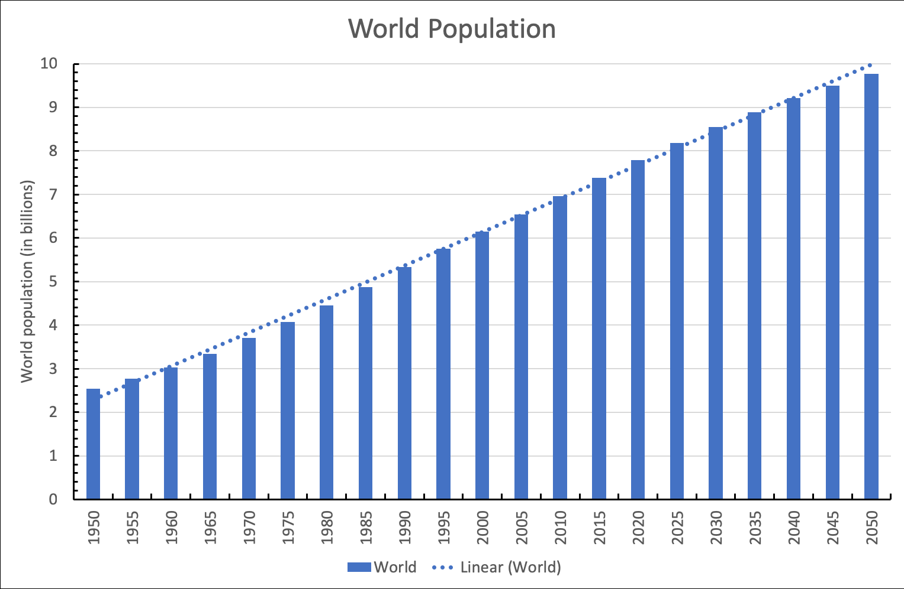
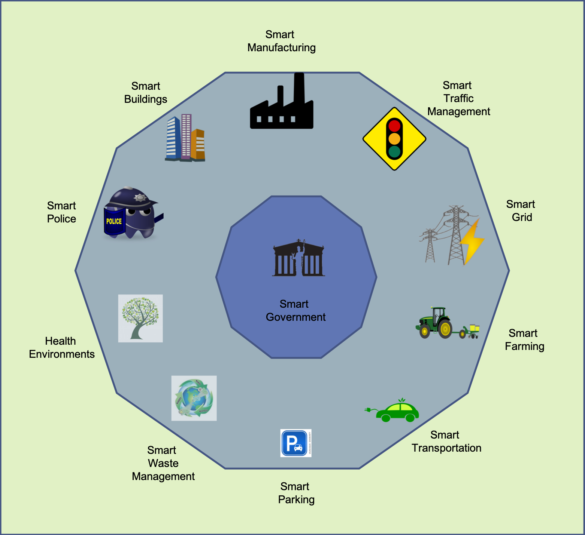
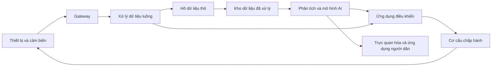

# BÁO CÁO NỘI DUNG CHƯƠNG 11
## AI CHO IoT TRONG THÀNH PHỐ THÔNG MINH
### (Chapter 11: AI for Smart Cities IoT)

| | |
|---|---|
| **Sách** | *Hands-On Artificial Intelligence for IoT* – Amita Kapoor, Packt Publishing, xuất bản tháng 1/2019, ISBN 978-1-78883-606-7 |
| **Chương** | 11 – AI for Smart Cities IoT |
| **Vị trí** | Trang 320–337 bản in (trang 333–350 của file PDF) |
| **Code kèm theo** | `Chapter11/SF_crime_category_detection.ipynb` |
| **Ngày đối chiếu** | 16/10/2026 |
| **Báo cáo liên quan** | [Báo cáo chạy code Chương 11](Bao_cao_chay_code_Chuong_11.md) |

> Ghi chú: số trang trong báo cáo này là **số trang in trên sách**. Muốn tra trong file PDF thì cộng thêm 13 (ví dụ trang 332 bản in là trang 345 của PDF).

> Phạm vi: báo cáo tổng hợp và diễn giải toàn bộ Chương 11, đồng thời đối chiếu phần thực hành với notebook và dữ liệu đi kèm. Các mốc thời gian, dự báo dân số, mô tả sản phẩm và số liệu hiệu quả của các thành phố là **thông tin được sách dẫn tại thời điểm biên soạn**, không phải số liệu được cập nhật hay xác minh lại cho năm 2026. Phần nhận xét kỹ thuật được tách riêng ở mục 9.

---

## Mục lục

1. [Giới thiệu và mục tiêu chương](#1-giới-thiệu-và-mục-tiêu-chương)
2. [Vì sao cần thành phố thông minh?](#2-vì-sao-cần-thành-phố-thông-minh)
3. [Các thành phần của thành phố thông minh](#3-các-thành-phần-của-thành-phố-thông-minh)
4. [Áp dụng IoT cho thành phố thông minh và các bước cần thiết](#4-áp-dụng-iot-cho-thành-phố-thông-minh-và-các-bước-cần-thiết)
5. [Các thành phố có dữ liệu mở](#5-các-thành-phố-có-dữ-liệu-mở)
6. [Phát hiện tội phạm từ dữ liệu San Francisco](#6-phát-hiện-tội-phạm-từ-dữ-liệu-san-francisco)
7. [Thách thức và lợi ích](#7-thách-thức-và-lợi-ích)
8. [Tóm tắt chương](#8-tóm-tắt-chương)
9. [Nhận xét và đánh giá](#9-nhận-xét-và-đánh-giá)
10. [Bảng thuật ngữ đề xuất](#10-bảng-thuật-ngữ-đề-xuất)
11. [Nguồn đối chiếu và giới hạn báo cáo](#11-nguồn-đối-chiếu-và-giới-hạn-báo-cáo)

**Cấu trúc chương theo sách:**

| Mục trong sách | Trang in | Loại nội dung |
|---|---|---|
| Phần mở đầu | 320 | Mục tiêu chương |
| Why do we need smart cities? | 321–322 | Lý thuyết |
| Components of a smart city (6 mục con) | 323–328 | Lý thuyết và ví dụ thực tế |
| Adapting IoT for smart cities and the necessary steps | 328–329 | Lý thuyết |
| Cities with open data (Atlanta MARTA, Chicago Array of Things) | 330–332 | Giới thiệu dữ liệu, có đoạn code gọi API |
| Detecting crime using San Francisco crime data | 332–336 | **Thực hành có code** |
| Challenges and benefits | 336 | Lý thuyết |
| Summary | 337 | Tóm tắt |

---

## 1. Giới thiệu và mục tiêu chương

Đây là chương cuối trong ba chương **nghiên cứu tình huống** của sách (Chương 9–11): Chương 9 bàn về IoT cá nhân và nhà thông minh, Chương 10 về IoT công nghiệp, Chương 11 về thành phố thông minh. Chương 11 dùng các ví dụ thực tế (case study) để cho thấy kiến thức AI/ML ở các chương trước được áp dụng thế nào vào các thành phần của thành phố thông minh.

Sau khi đọc chương, người đọc sẽ nắm được:

- Thành phố thông minh là gì.
- Các thành phần cốt lõi của một thành phố thông minh.
- Các thành phố trên thế giới đang triển khai giải pháp thông minh ra sao.
- Những thách thức khi xây dựng thành phố thông minh.
- Cách viết code nhận diện loại tội phạm từ mô tả vụ việc trong dữ liệu tội phạm San Francisco.

---

## 2. Vì sao cần thành phố thông minh?
*(trang 321–322)*

### 2.1. Áp lực từ đô thị hóa

Tác giả mở đầu bằng số liệu dân số của Liên Hợp Quốc:

- Dân số thế giới dự kiến đạt **9,7 tỷ người vào cuối năm 2050**.
- Gần **70%** trong số đó sống ở đô thị, và nhiều thành phố sẽ có trên 10 triệu dân.



*Hình 11.1. Dự báo dân số thế giới (dữ liệu Liên Hợp Quốc). Dân số tăng gần tuyến tính từ khoảng 2,5 tỷ (1950) lên gần 10 tỷ (2050).*

Đô thị hóa vừa mở ra cơ hội, vừa đặt ra những thách thức riêng:

- **Tài nguyên và năng lượng**: sách dẫn tỷ lệ các thành phố tiêu thụ **75% tài nguyên và năng lượng** của thế giới và thải ra **80% khí nhà kính**. Dù đã có xu hướng chuyển sang năng lượng xanh, các tài nguyên như lương thực và nước vẫn có hạn. Bài toán khó nhất là cung cấp đủ cho mọi người dân mà không làm môi trường xuống cấp.
- **Quản lý và điều hành**: dân số càng tăng, càng cần chiến lược ngăn ngừa vấn đề vệ sinh, giảm ùn tắc giao thông và chống tội phạm.

### 2.2. Định nghĩa thành phố thông minh

Theo Techopedia, **thành phố thông minh** là thành phố dùng công nghệ thông tin và truyền thông (ICT) để nâng cao chất lượng và hiệu quả của dịch vụ đô thị (như năng lượng, giao thông), nhờ đó giảm tiêu thụ tài nguyên, giảm lãng phí và giảm tổng chi phí.

Deakin và Al Waer (2011, *From intelligent to smart cities*, tạp chí *Intelligent Buildings International*, 3(3), 140–152) nêu **bốn yếu tố** cấu thành định nghĩa thành phố thông minh:

1. Dùng nhiều loại công nghệ điện tử và số trong hạ tầng thành phố.
2. Dùng ICT để thay đổi môi trường sống và làm việc.
3. Đưa ICT vào hệ thống của chính quyền.
4. Có chính sách và cách làm gắn kết con người với ICT để thúc đẩy đổi mới sáng tạo và làm giàu tri thức.

Như vậy, thành phố thông minh không chỉ là thành phố **có** ICT, mà phải **dùng** công nghệ theo cách tác động tích cực đến người dân.

### 2.3. Vai trò của AI kết hợp IoT

AI kết hợp IoT có thể giải quyết các thách thức chính của đô thị quá tải: quản lý giao thông, y tế, khủng hoảng năng lượng và nhiều vấn đề khác. Dữ liệu IoT cùng công nghệ AI giúp cải thiện cuộc sống của người dân và doanh nghiệp trong thành phố.

---

## 3. Các thành phần của thành phố thông minh
*(trang 323–328)*

Thành phố thông minh có rất nhiều ứng dụng cho công nghệ IoT dùng AI, từ giữ gìn môi trường đến cải thiện giao thông công cộng và an ninh. Hình 11.2 tổng hợp các thành phần này.



*Hình 11.2. Các thành phần của thành phố thông minh. Trung tâm là chính quyền thông minh (Smart Government), bao quanh là: sản xuất thông minh, quản lý giao thông thông minh, lưới điện thông minh, nông nghiệp thông minh, vận tải thông minh, bãi đỗ xe thông minh, quản lý chất thải thông minh, môi trường sống lành mạnh, cảnh sát thông minh, tòa nhà thông minh.*

Sách đi sâu vào **sáu** thành phần phổ biến nhất, phần lớn đã được triển khai thực tế:

### 3.1. Quản lý giao thông thông minh (Smart traffic management)
*(trang 324)*

**Mục tiêu:** giúp người dân di chuyển giữa các điểm trong thành phố an toàn và hiệu quả nhất.

**Ví dụ Los Angeles**, một trong những thành phố tắc đường nhất thế giới:

- Lắp **cảm biến mặt đường** và **camera giám sát (CCTV)**, gửi dữ liệu lưu lượng theo thời gian thực về hệ thống quản lý giao thông trung tâm.
- Hệ thống phân tích dữ liệu và thông báo cho người dùng khi có ùn tắc hoặc đèn tín hiệu hỏng.
- **Tháng 7/2018**: lắp thêm tủ điều khiển giao thông nâng cao (Advanced Transportation Controller, ATC) ở mỗi giao lộ. Tủ ATC có giao tiếp **xe với hạ tầng (V2I)** và kết nối **5G**, nên trao đổi được với các xe có tính năng thông tin đèn giao thông, như Audi A4 hoặc Q7.

**Hướng phát triển:**

- Xe tự hành gắn cảm biến cung cấp được vị trí và tốc độ, có thể giao tiếp trực tiếp với đèn giao thông thông minh để tránh ùn tắc.
- Dùng dữ liệu lịch sử để dự đoán lưu lượng tương lai và phòng ngừa ùn tắc.

### 3.2. Bãi đỗ xe thông minh (Smart parking)
*(trang 324–325)*

**Nguyên lý:** gắn cảm biến dưới mặt đường ở từng chỗ đỗ để biết chỗ trống hay có xe, từ đó tạo bản đồ chỗ đỗ theo thời gian thực.

| Thành phố | Thời điểm | Giải pháp | Kết quả theo sách |
|---|---|---|---|
| **Adelaide** (Úc) | Tháng 2/2018 | Hệ thống đỗ xe thông minh và ứng dụng *Park Adelaide*: tìm chỗ, thanh toán và gia hạn từ xa, chỉ đường tới chỗ trống, thông báo sắp hết giờ | Mục tiêu: cải thiện lưu thông, giảm ùn tắc, giảm phát thải carbon |
| **San Francisco** (SFpark) | Năm 2013 (theo sách) | Cảm biến không dây phát hiện chỗ đỗ có đồng hồ tính tiền | Giảm 25% khí nhà kính các ngày trong tuần; lưu lượng xe giảm; thời gian tìm chỗ giảm 50%; doanh thu đỗ xe tăng khoảng 1,9 triệu USD nhờ giảm thất thoát do đồng hồ hỏng |
| **Westminster** (London) | Năm 2014 | Hợp tác với Machina Research | Trước đây tài xế mất trung bình 12 phút tìm chỗ; nay tìm qua điện thoại, giảm ùn tắc và ô nhiễm, tăng doanh thu |

### 3.3. Quản lý chất thải thông minh (Smart waste management)
*(trang 325–326)*

Thu gom và xử lý rác là dịch vụ thiết yếu. Dân số đô thị tăng buộc phải có cách quản lý rác thông minh hơn, và AI giúp tái chế thông minh, bền vững.

- **ZenRobotics (Phần Lan, 2011)**: trình diễn robot dùng thị giác máy tính và AI để phân loại và nhặt vật liệu tái chế trên băng chuyền.
- **Barcelona (Tây Ban Nha)**:
  - Cảm biến gắn trên thùng rác báo cho chính quyền khi thùng sắp đầy, để điều xe thu gom kịp thời.
  - Mỗi khu dân cư có thùng riêng cho giấy, nhựa, thủy tinh và rác thực phẩm.
  - Mạng lưới thùng chứa nối với **ống hút chân không ngầm**, hút rác thẳng về nhà máy xử lý, không cần xe chở rác.
- **Đan Mạch**: SmartBin hợp tác với TDC (nhà mạng lớn nhất Đan Mạch) và Cisco, gắn cảm biến lên các thùng chứa và tích hợp vào nền tảng số của thành phố (City Digital Platform). Cột đèn và đèn giao thông cũng gắn cảm biến gửi dữ liệu về trung tâm điều khiển ở tòa thị chính. Nhờ dữ liệu thời gian thực, đội vệ sinh lên lộ trình hiệu quả, chỉ đến nơi cần đổ rác.
- **Sharjah (UAE)**: lắp 10 thùng rác Bigbelly chạy năng lượng mặt trời có Wi-Fi, dự kiến mở rộng lên hàng trăm thùng.

### 3.4. An ninh trật tự thông minh (Smart policing)
*(trang 326–327)*

**Khái niệm:** cơ quan thực thi pháp luật dùng chiến lược **dựa trên bằng chứng và dữ liệu** để làm việc hiệu quả, tiết kiệm. Khái niệm xuất hiện khoảng năm 2009, chủ yếu do ngân sách bị hạn chế.

**Nền tảng tư tưởng:** Herman Goldstein (Đại học Wisconsin, 1979) cho rằng cảnh sát không nên coi mỗi vụ phạm tội là sự kiện riêng lẻ, mà là một hệ thống vấn đề có quá khứ và tương lai.

**Ví dụ thực tế:**

- **Mỹ**: Cục Hỗ trợ Tư pháp (Bureau of Justice Assistance, BJA) tài trợ nhiều Sáng kiến An ninh Thông minh (Smart Policing Initiatives, SPI), giúp giảm đáng kể tội phạm bạo lực.
  - SPI dựa trên hợp tác giữa cảnh sát và đơn vị nghiên cứu. Đơn vị nghiên cứu liên tục thu thập và phân tích dữ liệu, theo dõi, cùng xây dựng giải pháp và đánh giá tác động.
  - Nhờ đó cảnh sát xác định được **điểm nóng tội phạm** (hot-spots) và **đối tượng phạm tội nhiều lần** (prolific offenders).
- **Singapore** (sáng kiến *Smart Nation*):
  - Mạng camera và cảm biến phủ gần như mọi góc phố, dùng để phát hiện người hút thuốc ở khu vực cấm hay lảng vảng quanh nhà cao tầng.
  - Camera còn theo dõi mật độ đám đông, độ sạch của nơi công cộng và cả hành trình của mọi phương tiện đã đăng ký.
  - Dữ liệu camera đưa vào nền tảng trực tuyến *Virtual Singapore*, cho biết tình trạng vận hành của thành phố theo thời gian thực.

### 3.5. Chiếu sáng thông minh (Smart lighting)
*(trang 327)*

Đèn đường cần thiết nhưng tốn nhiều điện. Chiếu sáng thông minh giúp tiết kiệm năng lượng; cột đèn còn có thể gắn thêm cảm biến hoặc làm điểm phát Wi-Fi.

- **CitySense (hãng Tvilight)**: cảm biến chuyển động cho đèn đường, từng đoạt giải, tích hợp điều khiển chiếu sáng không dây.
  - Chịu được môi trường ngoài trời khắc nghiệt, chiếu sáng theo nhu cầu: đèn tự chỉnh độ sáng khi có người đi bộ, xe đạp hay ô tô.
  - Dùng **mạng lưới (mesh) thời gian thực** để bật các đèn lân cận, tạo "vòng sáng an toàn" quanh người đang di chuyển.
  - Có bộ lọc loại nhiễu do thú nhỏ hoặc cây đung đưa; tự phát hiện đèn hỏng và gửi yêu cầu bảo trì.
  - Làng Van Gogh (Hà Lan) dùng CitySense cho đèn đường.
- **Barcelona** (kế hoạch tổng thể về chiếu sáng): khoảng năm 2014, phần lớn cột đèn được thay bóng LED và gắn cảm biến IoT. Đèn tự dịu khi đường vắng, giảm đáng kể điện năng. Cột đèn đồng thời làm điểm phát Wi-Fi và gắn cảm biến đo chất lượng không khí.

### 3.6. Quản trị thông minh (Smart governance)
*(trang 328)*

Mục đích chính của thành phố thông minh là cuộc sống thoải mái, tiện lợi cho người dân, nên hạ tầng thông minh không thể thiếu **quản trị thông minh**:

- Dùng ICT một cách thông minh để cải thiện việc ra quyết định, thông qua hợp tác tốt hơn giữa các bên, gồm chính quyền và người dân.
- Là nền tảng cho chính quyền thông minh, minh bạch và có sự tham gia của người dân.
- Đòi hỏi định hình lại vai trò của chính quyền, người dân và các tổ chức xã hội, và áp dụng công nghệ mới để xây dựng mô hình quản trị mới: quan hệ mới, quy trình mới, cơ cấu chính quyền mới.
- Dùng dữ liệu và bằng chứng để ra quyết định tốt hơn và cung cấp dịch vụ công đáp ứng nhu cầu người dân.

---

## 4. Áp dụng IoT cho thành phố thông minh và các bước cần thiết
*(trang 328–329)*

### 4.1. Các thành phần bắt buộc của một nền tảng IoT

Xây dựng thành phố thông minh không phải việc ngày một ngày hai, cũng không phải việc của một người hay một tổ chức; nó cần nhiều đối tác chiến lược, lãnh đạo và cả người dân cùng tham gia. Từ góc nhìn kỹ sư AI, tác giả liệt kê những gì một nền tảng IoT **nhất thiết phải có**:

| # | Thành phần | Vai trò |
|---|---|---|
| 1 | Mạng lưới **thiết bị thông minh** (cảm biến, camera, cơ cấu chấp hành, …) | Thu thập dữ liệu |
| 2 | **Cổng kết nối** hiện trường hoặc đám mây (field/cloud gateway) | Gom dữ liệu từ thiết bị IoT công suất thấp, lưu tạm và chuyển an toàn lên đám mây |
| 3 | **Bộ xử lý dữ liệu luồng** (streaming data processor) | Gộp nhiều luồng dữ liệu, phân phối tới hồ dữ liệu và ứng dụng điều khiển |
| 4 | **Hồ dữ liệu** (data lake) | Lưu toàn bộ dữ liệu thô, kể cả dữ liệu tạm thời chưa thấy giá trị |
| 5 | **Kho dữ liệu** (data warehouse) | Làm sạch và cấu trúc hóa dữ liệu đã thu |
| 6 | Công cụ **phân tích và trực quan hóa** | Phân tích, hiển thị dữ liệu cảm biến |
| 7 | **Thuật toán AI** | Tự động hóa dịch vụ đô thị dựa trên phân tích dữ liệu dài hạn, cải thiện hiệu năng ứng dụng điều khiển |
| 8 | **Ứng dụng điều khiển** (control application) | Gửi lệnh xuống cơ cấu chấp hành IoT |
| 9 | **Ứng dụng cho người dùng** | Kết nối thiết bị thông minh với người dân |

Ngoài ra, nhà cung cấp dịch vụ còn phải bảo đảm **an ninh và quyền riêng tư**, không để dịch vụ thông minh đe dọa người dân. Dịch vụ cũng phải dễ dùng thì người dân mới chịu áp dụng.

Sơ đồ dưới đây diễn giải luồng dữ liệu và điều khiển từ chín thành phần trong sách; đây là sơ đồ tổng hợp của báo cáo:



IoT tạo khả năng quan sát và tác động lên môi trường; AI sử dụng dữ liệu để hỗ trợ dự đoán, phân loại và ra quyết định. Hiệu quả của hệ thống phải được đánh giá bằng kết quả dịch vụ đô thị, chẳng hạn thời gian chờ, lượng điện tiêu thụ hoặc mức độ đáp ứng nhu cầu người dân, bên cạnh chất lượng mô hình.

### 4.2. Cơ hội cho kỹ sư AI

Dữ liệu IoT cần được xử lý vượt xa mức giám sát và phân tích cơ bản:

- Công cụ AI tìm ra quy luật và tương quan ẩn trong dữ liệu cảm biến.
- Phân tích dữ liệu lịch sử bằng ML/AI giúp nhận ra xu hướng và xây mô hình dự đoán.
- Ứng dụng điều khiển dùng các mô hình này để gửi lệnh xuống cơ cấu chấp hành của thiết bị IoT.

Vì vậy, lĩnh vực này mở ra nhiều cơ hội việc làm và khởi nghiệp cho kỹ sư AI.

### 4.3. Ví dụ: cải tiến đèn giao thông thông minh qua từng vòng lặp

Xây thành phố thông minh là một **quá trình lặp**, mỗi vòng thêm khâu xử lý và phân tích. Tác giả minh họa bằng đèn giao thông:

| Vòng lặp | Bổ sung | Mô hình AI làm gì |
|---|---|---|
| 1 | Đèn tự điều chỉnh thời gian tín hiệu theo lưu lượng | Học quy luật giao thông từ dữ liệu lịch sử, chỉnh thời gian đèn để tăng tối đa tốc độ trung bình và tránh ùn tắc |
| 2 | Hệ thống xử lý phát hiện ùn tắc theo khu vực | Dùng dữ liệu cảm biến của đèn để phát hiện ùn tắc, kết hợp GPS từ xe hoặc điện thoại để báo tài xế gần đó tránh tuyến |
| 3 | Gắn thêm cảm biến chất lượng không khí lên đèn | Huấn luyện mô hình để cảnh báo **trước khi** chất lượng không khí chạm ngưỡng nguy hiểm |

---

## 5. Các thành phố có dữ liệu mở
*(trang 330–332)*

Trong giai đoạn được sách đề cập, nhiều thành phố lập **cổng dữ liệu mở** (open data portal). Cổng dữ liệu mở vừa giúp người dân nắm thông tin, vừa là nguồn dữ liệu cho người làm AI. Sách dẫn một bài báo trên Forbes (2018) liệt kê 90 thành phố Mỹ có cổng dữ liệu mở, rồi giới thiệu ba nguồn cụ thể.

### 5.1. Dữ liệu giao thông công cộng Atlanta (MARTA)
*(trang 330–331)*

Cơ quan Giao thông Đô thị Atlanta (Metropolitan Atlanta Rapid Transit Authority, MARTA) công bố dữ liệu giao thông công cộng theo thời gian thực để lập trình viên phát triển ứng dụng web và di động. Dữ liệu được cung cấp theo hai cách:

1. **Định dạng GTFS** (General Transit Feed Specification): chuẩn cho lịch trình và thông tin địa lý giao thông công cộng. GTFS gồm nhiều file văn bản, mỗi file mô tả một khía cạnh như điểm dừng, tuyến, chuyến và lịch chạy.
2. **API kiểu RESTful**, truy cập qua thư viện Python **MARTA-Python**:
   - Đăng ký tài khoản lập trình viên để lấy **khóa API**, rồi lưu khóa vào biến môi trường `MARTA_API_KEY` (lệnh `set` trên Windows, `export` trên Linux/macOS).
   - Thư viện có hai hàm chính:

| Hàm | Trả về | Tham số lọc |
|---|---|---|
| `get_buses()` | Danh sách xe buýt (đối tượng `Bus`) | `route`: số tuyến |
| `get_trains()` | Danh sách tàu (đối tượng `Train`) | `line`: tuyến màu (red, blue, …); `station`: ga; `destination`: điểm đến. Có thể kết hợp nhiều tham số |

> Lưu ý: sách ghi lệnh `pip install tox`, trong khi ví dụ nhập module `marta.api`; vì vậy đoạn hướng dẫn này chưa đủ để chứng minh đã cài đúng thư viện phục vụ ví dụ. Báo cáo ghi nhận sự không nhất quán và không xem API MARTA đã được kiểm thử ở môi trường hiện tại.

Đoạn gọi API minh họa trong sách có dạng:

```python
from marta.api import get_buses, get_trains

buses_route = get_buses(route=1)
trains_red = get_trains(line="red")
trains_station = get_trains(station="Midtown Station")
trains_all = get_trains(
    line="blue",
    station="Five Points Station",
    destination="Indian Creek",
)
```

Đây là ví dụ lịch sử được trích để giải thích cách lọc dữ liệu; chưa gọi API thực tế, chưa cấp khóa API và chưa xác nhận các endpoint còn hoạt động. Lệnh `set MARTA_API_KEY=...` được sách ghi cho Windows thuộc cú pháp Command Prompt; nếu dùng PowerShell phải sử dụng cú pháp biến môi trường của PowerShell.

### 5.2. Dữ liệu cảm biến Chicago (Array of Things)
*(trang 332)*

Dự án **Array of Things (AoT)** khởi động năm 2016: lắp mạng **hộp cảm biến trên cột đèn đường** để thu dữ liệu thời gian thực về môi trường xung quanh và hoạt động đô thị. Dữ liệu được công bố cho lập trình viên dưới dạng tải hàng loạt và qua API.

Mô hình dữ liệu của AoT:

| Khái niệm | Ý nghĩa |
|---|---|
| **Project** (dự án) | Mỗi khu vực triển khai; lớn nhất là dự án *Chicago* |
| **Node** (nút) | Thiết bị vật lý lắp ngoài thực địa, định danh bằng số sê-ri VSN; các nút nối thành mạng |
| **Sensor** (cảm biến) | Nằm trong nút, đo nhiệt độ, độ ẩm, cường độ ánh sáng, bụi mịn, … |
| **Observation** (quan sát) | Bản ghi giá trị đo được, có dư thừa, lấy ở dạng thô qua API |

Quan hệ dữ liệu: node–observation và sensor–observation là **một–nhiều**; project, node và sensor quan hệ **nhiều–nhiều** với nhau. Toàn bộ dữ liệu có trên cổng dữ liệu mở của Chicago (data.cityofchicago.org).

### 5.3. Dữ liệu tội phạm San Francisco
San Francisco cũng có cổng dữ liệu mở (datasf.org) với dữ liệu của nhiều sở ngành. Sách dùng dữ liệu này cho phần thực hành ở mục 6.

---

## 6. Phát hiện tội phạm từ dữ liệu San Francisco
*(trang 332–336)*

Đây là **phần thực hành duy nhất có code đầy đủ** của chương. Chi tiết cài đặt, chạy code và phân tích kết quả nằm trong [Báo cáo chạy code Chương 11](Bao_cao_chay_code_Chuong_11.md); phần này chỉ tóm tắt nội dung sách.

### 6.1. Bài toán

- **Dữ liệu**: báo cáo tội phạm của mọi khu dân cư ở San Francisco trong khoảng **12 năm (1/2003 – 5/2015)**.
- **Mục tiêu**: dự đoán **loại tội phạm** (`Category`) từ **đoạn mô tả vụ việc** (`Descript`).
- **Kiểu bài toán**: **phân loại đa lớp** với 39 loại tội phạm.
- **Công cụ**: Apache **PySpark**, vì có sẵn các công cụ xử lý văn bản dễ dùng.

### 6.2. Các bước thực hiện theo sách

| Bước | Nội dung |
|---|---|
| 1 | Import các module của PySpark và tạo phiên Spark (`SparkSession`) |
| 2 | Đọc dữ liệu từ file CSV; dữ liệu có 9 cột: `Dates, Category, Descript, DayOfWeek, PdDistrict, Resolution, Address, X, Y` |
| 3 | Chỉ giữ hai cột `Category` (nhãn) và `Descript` (đầu vào) |
| 4 | Xử lý văn bản bằng một chuỗi xử lý (*pipeline*): **(a)** `RegexTokenizer` tách văn bản thành từ; **(b)** `StopWordsRemover` bỏ bảy từ được khai báo; **(c)** `CountVectorizer` tạo vector đếm với giới hạn 10.000 từ và chỉ giữ từ xuất hiện trong ít nhất 5 bản ghi; **(d)** `StringIndexer` chuyển nhãn dạng chữ thành chỉ số số học |
| 5 | Chia ngẫu nhiên 70% dữ liệu để huấn luyện, 30% để kiểm tra (`seed = 100`) |
| 6 | Huấn luyện **hồi quy logistic** (`maxIter=20, regParam=0.3, elasticNetParam=0`) và đánh giá bằng `MulticlassClassificationEvaluator` |

### 6.3. Kết quả theo sách

Sách gọi kết quả là khoảng **97% "accuracy"** trên tập kiểm tra. Notebook gốc lưu **0,9725282146509521**. Đối chiếu cách cấu hình evaluator cho thấy chỉ số được tính là **weighted F1**, tức F1 trung bình có trọng số theo số mẫu mỗi lớp. Lần chạy kiểm chứng trên máy hiện tại cho kết quả **0,9725533704587821**, tương đương khoảng **97,2553% weighted F1**. Accuracy chưa được đo riêng trong lần kiểm chứng này. Chi tiết và giới hạn tái lập nằm trong báo cáo chạy code.

---

## 7. Thách thức và lợi ích
*(trang 336)*

AI đang thay đổi cách thành phố vận hành, cung cấp và duy trì dịch vụ công, từ chiếu sáng, giao thông đến kết nối mạng và y tế. Tác giả nêu ba nhóm thách thức:

1. **Lựa chọn và tích hợp công nghệ**: chọn công nghệ không tương thích với nhau, hoặc không tích hợp được với dịch vụ khác của thành phố, sẽ cản trở việc triển khai. Vì vậy nên ưu tiên giải pháp **nâng cấp trên hạ tầng sẵn có** (retrofit).
2. **Hợp tác và tư duy**: chính quyền phải lập kế hoạch dài hạn và liên ngành. Kỹ sư công nghệ, chính quyền địa phương, doanh nghiệp, các nhà môi trường và người dân phải cùng chung tay.
3. **Ngân sách**: dù là trở ngại lớn, các dự án thành công trên thế giới cho thấy nếu triển khai đúng cách, thành phố thông minh **tiết kiệm hơn**.

**Lợi ích:** tạo việc làm, bảo vệ môi trường, giảm chi phí năng lượng và tăng nguồn thu. Ví dụ tiêu biểu là **Barcelona**: nhờ các hệ thống IoT, thành phố tạo ra khoảng **47.000 việc làm**, tiết kiệm **42,5 triệu euro** tiền nước và thu thêm **36,5 triệu euro mỗi năm** từ đỗ xe thông minh.

---

## 8. Tóm tắt chương
*(trang 337)*

- Giải pháp IoT dùng AI giúp kết nối thành phố và quản lý nhiều loại hạ tầng, dịch vụ công.
- Chương đã đi qua nhiều ứng dụng của thành phố thông minh: chiếu sáng, giao thông đường bộ, giao thông công cộng kết nối, quản lý chất thải.
- Các ví dụ thành công cho thấy thành phố thông minh giúp giảm chi phí năng lượng, dùng tài nguyên tối ưu hơn, an toàn hơn và môi trường trong lành hơn.
- Chương giới thiệu một số cổng dữ liệu mở và dữ liệu có sẵn trên đó.
- Phần thực hành dùng công cụ đã học trong sách để phân loại báo cáo tội phạm 12 năm của San Francisco.
- Cuối cùng, chương bàn về thách thức và lợi ích khi xây dựng thành phố thông minh.

---

## 9. Nhận xét và đánh giá

### 9.1. Điểm mạnh

- **Bao quát**: giới thiệu đầy đủ các thành phần chính của thành phố thông minh, kèm ví dụ thực tế có thời gian, địa điểm và số liệu cụ thể ở nhiều quốc gia (Mỹ, Úc, Anh, Tây Ban Nha, Đan Mạch, Phần Lan, Hà Lan, Singapore, UAE).
- **Gắn lý thuyết với hệ thống**: mục 4 trình bày kiến trúc nền tảng IoT 9 thành phần và quá trình cải tiến lặp, có thể dùng trực tiếp làm khung thiết kế hệ thống.
- **Hướng thực hành**: chỉ ra các nguồn dữ liệu mở thật (MARTA, Array of Things, DataSF) để người đọc tự phát triển ứng dụng.

### 9.2. Hạn chế

- **Phần code gần như không dùng dữ liệu cảm biến**: ví dụ San Francisco phân loại **văn bản mô tả** do cảnh sát ghi lại, không phải dữ liệu đo từ thiết bị IoT. Hai nguồn dữ liệu cảm biến thật (MARTA, Array of Things) chỉ được giới thiệu, không có bài thực hành hoàn chỉnh.
- **Khả năng khái quát cần được đánh giá thêm**: dữ liệu có 879 mô tả khác nhau, trong đó 871 mô tả chỉ gắn với một loại. Tra nhãn phổ biến nhất của từng mô tả rồi tính ngay trên toàn bộ chính dữ liệu ấy đạt khoảng 99,73% accuracy. Đây chỉ là **thống kê mô tả trong mẫu**, không phải kết quả kiểm tra trên dữ liệu độc lập và không thể so trực tiếp với weighted F1 của mô hình. Nó cho thấy mô tả lặp lại nhiều và có quan hệ rất mạnh với nhãn.
- **Số liệu theo thời điểm 2018**: nhiều ví dụ thực tế và đường dẫn có thể đã thay đổi. Khi trình bày nên ghi rõ đây là số liệu theo sách.

### 9.3. Các điểm cần hiệu đính khi đọc sách và tái hiện

| # | Vị trí | Nội dung trong sách | Thực tế | Cách nhóm kiểm chứng |
|---|---|---|---|---|
| 1 | Trang 332 và 334 | Trang 332 ghi 39 loại tội phạm; trang 334 lại ghi "36 distinct categories" | Dữ liệu có **39** loại | Đếm trên file dữ liệu |
| 2 | Trang 334–335 | Chú thích `StringIndexer` là "one hot encoding the label" | `StringIndexer` chỉ gán **số thứ tự** cho nhãn theo tần suất (LARCENY/THEFT → 0, OTHER OFFENSES → 1, …), không mã hóa one-hot | Xem cột `label` trong kết quả chạy |
| 3 | Trang 336 | "97% accuracy" | Giá trị in ra là **weighted F1**; chưa đo accuracy riêng trong lần chạy kiểm chứng | Đối chiếu evaluator và mã nguồn Apache Spark |
| 4 | Trang 333 (bước 1) | Danh sách import | Thiếu `from pyspark.ml.evaluation import MulticlassClassificationEvaluator`, nên chép nguyên code in trong sách sẽ báo lỗi ở bước 6 (notebook trên GitHub thì có dòng này) | Đối chiếu code in với notebook |
| 5 | Trang 333 (bước 2) | Đọc file `sf_crime_dataset.csv` | Thư mục hiện tại có cả `train.csv` và `sf_crime_dataset.csv`, giống nhau từng byte; có thể dùng trực tiếp file được notebook yêu cầu | So sánh SHA-256, số dòng và schema |
| 6 | Trang 330–331 | Cài `tox` rồi nhập `marta.api` | Chưa có bằng chứng rằng chuỗi hướng dẫn cài đặt này đủ để chạy ví dụ MARTA | Đối chiếu lệnh cài và module được import; chưa kiểm thử API |

Ngoài các điểm trên, pipeline được fit trên toàn bộ dữ liệu trước khi chia train/test. Khi đánh giá nghiên cứu độc lập, nên chia trước rồi chỉ fit trên train. Tuy nhiên, báo cáo thực nghiệm giữ nguyên thứ tự của sách để tái hiện đúng quy trình, không âm thầm thay đổi phương pháp và gọi đó là kết quả gốc.

### 9.4. Liên hệ với phần thực hành và demo phần cứng

Kiến trúc 9 thành phần ở mục 4.1 có thể được minh họa bằng thiết kế nhỏ dưới đây. **Đây là đề xuất mở rộng của báo cáo, chưa triển khai hay kiểm chứng trên phần cứng, và không khẳng định người thực hiện đang sở hữu các thiết bị này.**

| Thành phần trong sách | Hiện thực đề xuất |
|---|---|
| Thiết bị thông minh, cơ cấu chấp hành | ESP32 kèm màn hình OLED, đèn LED và còi |
| Cổng kết nối | MQTT broker (Mosquitto) chạy trên Raspberry Pi 5 |
| Thuật toán AI | Dịch vụ phân loại văn bản chạy trên máy tính; Raspberry Pi làm cầu nối nếu cần |
| Ứng dụng điều khiển | Chương trình trên Pi gửi lệnh bật đèn, còi xuống ESP32 theo loại tội phạm |
| Ứng dụng người dùng | Trang web nhập mô tả sự cố trên điện thoại |

---

## 10. Bảng thuật ngữ đề xuất

Bảng dưới đây là đề xuất để các nhóm thống nhất thuật ngữ khi dịch.

| Tiếng Anh | Tiếng Việt đề xuất |
|---|---|
| Smart city | Thành phố thông minh |
| Smart traffic management | Quản lý giao thông thông minh |
| Smart parking | Bãi đỗ xe thông minh |
| Smart waste management | Quản lý chất thải thông minh |
| Smart policing | An ninh trật tự thông minh |
| Smart lighting | Chiếu sáng thông minh |
| Smart governance | Quản trị thông minh |
| Information and Communication Technology (ICT) | Công nghệ thông tin và truyền thông |
| Vehicle-to-infrastructure (V2I) | Giao tiếp xe với hạ tầng |
| Road-surface sensor | Cảm biến mặt đường |
| Actuator | Cơ cấu chấp hành |
| Field gateway / Cloud gateway | Cổng kết nối hiện trường / Cổng kết nối đám mây |
| Streaming data processor | Bộ xử lý dữ liệu luồng |
| Data lake | Hồ dữ liệu |
| Data warehouse | Kho dữ liệu |
| Control application | Ứng dụng điều khiển |
| Open data portal | Cổng dữ liệu mở |
| General Transit Feed Specification (GTFS) | Đặc tả nguồn cấp dữ liệu giao thông công cộng (giữ nguyên GTFS) |
| API key | Khóa API |
| Node / Sensor / Observation | Nút / Cảm biến / Quan sát (bản ghi đo) |
| Hot-spot (of crime) | Điểm nóng (tội phạm) |
| Prolific offender | Đối tượng phạm tội nhiều lần |
| Retrofitted solution | Giải pháp nâng cấp trên hạ tầng sẵn có |
| Multi-class classification | Phân loại đa lớp |
| Tokenizer | Bộ tách từ |
| Stop words | Từ dừng |
| Bag of words | Túi từ |
| Pipeline | Chuỗi xử lý (pipeline) |
| Logistic regression | Hồi quy logistic |
| Training / Test dataset | Tập huấn luyện / Tập kiểm tra |

---

## 11. Nguồn đối chiếu và giới hạn báo cáo

1. **Nguồn chính:** Amita Kapoor, *Hands-On Artificial Intelligence for IoT*, Packt, 2019, Chương 11, trang in 320–337; đối chiếu trực tiếp bản PDF trong thư mục làm việc. Các mục 1–8 tổng hợp theo nội dung chương; số liệu của các thành phố được dẫn theo sách.
2. **Mã nguồn gốc:** [SF_crime_category_detection.ipynb](SF_crime_category_detection.ipynb), cùng dữ liệu CSV trong thư mục `Chapter11`.
3. **Ý nghĩa mã hóa nhãn:** [tài liệu StringIndexer của Apache Spark](https://spark.apache.org/docs/4.0.0/api/python/reference/api/pyspark.ml.feature.StringIndexer.html).
4. **Ý nghĩa điểm đánh giá:** [tài liệu MulticlassClassificationEvaluator](https://spark.apache.org/docs/4.0.0/api/python/reference/api/pyspark.ml.evaluation.MulticlassClassificationEvaluator.html) và [mã nguồn evaluator của Apache Spark](https://github.com/apache/spark/blob/v4.0.0/mllib/src/main/scala/org/apache/spark/ml/evaluation/MulticlassClassificationEvaluator.scala#L133-L144).
5. **Bằng chứng thực nghiệm:** [Báo cáo chạy code Chương 11](Bao_cao_chay_code_Chuong_11.md), ghi rõ cấu hình máy, nguồn số liệu, kết quả quan sát và giới hạn tái lập.

Các tài liệu Spark 4.0.0 ở trên được dùng để đối chiếu ý nghĩa API; môi trường chạy kiểm chứng thực tế là Spark 4.2.0. Báo cáo không xem hai môi trường này là cùng một phiên bản. Phần minh họa IoT mở rộng, sơ đồ tổng hợp và nhận xét phương pháp là diễn giải của báo cáo, không phải thí nghiệm bổ sung đã được thực hiện trong sách.
