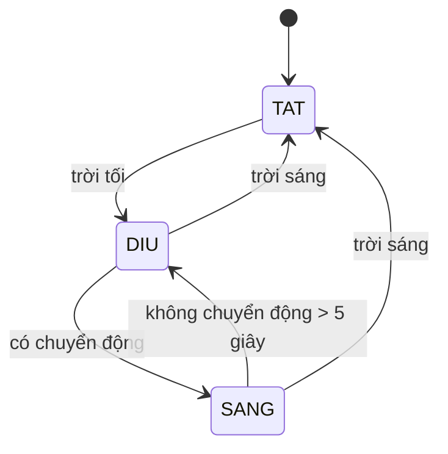

# THIẾT KẾ DEMO PHẦN CỨNG – ĐÈN ĐƯỜNG THÔNG MINH
### Chương 11 – AI for Smart Cities IoT

| | |
|---|---|
| **Mục tiêu** | Mô phỏng một đèn đường thông minh: tự bật khi trời tối, sáng dịu khi đường vắng, sáng tối đa khi có người đi qua, và ước tính điện năng tiết kiệm được |
| **Liên hệ sách** | Mục "Smart lighting" (trang 327 bản in): đèn CitySense tự chỉnh độ sáng theo người đi đường; Barcelona cho đèn dịu khi đường vắng để giảm điện năng |
| **Phần cứng chính** | ESP32, cảm biến chuyển động PIR, cảm biến ánh sáng (quang trở), LED |
| **Không cần** | Raspberry Pi, mạng Wi-Fi, máy chủ |

---

## 1. Chức năng

| Trạng thái | Điều kiện | Độ sáng LED |
|---|---|---|
| **TẮT** | Trời sáng | 0% |
| **DỊU** | Trời tối, không có chuyển động | 20% |
| **SÁNG** | Trời tối, có chuyển động | 100% |

Đèn giữ trạng thái SÁNG thêm **5 giây** sau lần cuối phát hiện chuyển động, rồi chuyển dần về DỊU trong khoảng 1 giây.



---

## 2. Linh kiện

| # | Linh kiện | Số lượng | Vai trò |
|---|---|---|---|
| 1 | ESP32 DevKit | 1 | Bộ điều khiển |
| 2 | Cảm biến chuyển động PIR HC-SR501 | 1 | Phát hiện người đi qua |
| 3 | Quang trở (LDR) và điện trở 10 kΩ (hoặc module cảm biến ánh sáng) | 1 bộ | Phân biệt ngày / đêm |
| 4 | LED trắng siêu sáng và điện trở 220 Ω | 1–2 bộ | Đóng vai bóng đèn đường |
| 5 | Màn OLED SSD1306 0.96" I2C *(tùy chọn)* | 1 | Hiện trạng thái, % điện tiết kiệm |
| 6 | Breadboard, dây cắm, cáp USB | – | Lắp mạch, cấp nguồn |

---

## 3. Nối dây

| Linh kiện | Chân linh kiện | Chân ESP32 |
|---|---|---|
| PIR HC-SR501 | VCC / GND / OUT | VIN (5V) / GND / **GPIO27** |
| Quang trở | Đầu 1 / Đầu 2 | 3V3 / **GPIO34**; từ GPIO34 nối thêm điện trở 10 kΩ xuống GND |
| LED (qua điện trở 220 Ω) | Chân dài / Chân ngắn | **GPIO25** / GND |
| OLED *(tùy chọn)* | VCC / GND / SDA / SCL | 3V3 / GND / **GPIO21** / **GPIO22** |

**Ghi chú:**
- **Cách đọc cảm biến ánh sáng**: quang trở và điện trở 10 kΩ tạo cầu phân áp. Trời càng sáng, giá trị đọc ở GPIO34 càng cao (0–4095).
- **Vì sao chọn GPIO34**: chân này thuộc nhóm ADC1, vẫn đọc được analog khi bật Wi-Fi, nên không phải nối lại dây nếu sau này thêm trang web.
- **PIR**: chạy bằng nguồn 5V nhưng tín hiệu ra là 3,3V, nên an toàn cho ESP32.
- **Điều chỉnh độ sáng LED**: bằng PWM, tần số 5 kHz, độ phân giải 8 bit (0–255).

---

## 4. Thiết kế phần mềm

### 4.1. Tham số

| Tham số | Giá trị đề xuất | Ghi chú |
|---|---|---|
| Chu kỳ đọc cảm biến | 100 ms | |
| Ngưỡng "trời tối" | đọc < `NGUONG_TOI` | Đo thực tế trong phòng thuyết trình (xem 4.3) |
| Ngưỡng "trời sáng" | đọc > `NGUONG_SANG` | Đặt `NGUONG_SANG` cao hơn `NGUONG_TOI` khoảng 200 để đèn không nhấp nháy quanh ngưỡng |
| Độ sáng DỊU / SÁNG | 20% / 100% | |
| Thời gian giữ sau chuyển động | 5 giây | Cộng thêm thời gian giữ của chính cảm biến PIR |
| Thời gian chuyển độ sáng | 1 giây | Tăng / giảm dần cho mượt |
| Chu kỳ in trạng thái | 1 giây | |

### 4.2. Vòng lặp chính

```
mỗi 100 ms:
    anh_sang  ← đọc GPIO34
    toi       ← (anh_sang < NGUONG_TOI) hoặc (đang tối và anh_sang ≤ NGUONG_SANG)
    nếu đọc GPIO27 = HIGH: lan_cuoi_chuyen_dong ← bây giờ

    nếu không toi:                              muc_tieu ← 0%
    ngược lại nếu bây giờ − lan_cuoi_chuyen_dong < 5 s: muc_tieu ← 100%
    ngược lại:                                  muc_tieu ← 20%

    do_sang ← tiến dần về muc_tieu, rồi ghi PWM ra GPIO25

    nếu toi:                                    (tích lũy điện năng)
        dien_thuc_te   += do_sang × 0,1 s
        dien_luon_sang += 100%   × 0,1 s

mỗi 1 s: in trạng thái ra Serial và OLED
```

**Ước tính điện tiết kiệm:**

> tiết kiệm (%) = (1 − `dien_thuc_te` / `dien_luon_sang`) × 100

- So sánh với một đèn đường thường **luôn sáng 100% suốt thời gian trời tối**.
- Đây là con số ước tính, vì điện năng của LED chỉ xấp xỉ tỷ lệ với độ sáng PWM.

### 4.3. Hiệu chỉnh ngưỡng ánh sáng

1. Nạp code, mở Serial Monitor (115200 baud).
2. Ghi lại giá trị đọc khi để bình thường và khi lấy tay che quang trở.
3. Đặt `NGUONG_TOI` ở khoảng giữa hai giá trị đó, `NGUONG_SANG = NGUONG_TOI + 200`.

### 4.4. Dữ liệu hiển thị

Serial Monitor in mỗi giây một dòng, OLED hiện cùng nội dung:

```
anh_sang=812  troi=TOI  chuyen_dong=CO  do_sang=100%  tiet_kiem=64%
```

---

## 5. Kiểm thử

| # | Thao tác | Kết quả mong đợi |
|---|---|---|
| 1 | Phòng sáng, không ai | Đèn tắt |
| 2 | Che quang trở | Đèn sáng dịu 20% |
| 3 | Che quang trở và vẫy tay trước PIR | Đèn sáng 100% |
| 4 | Ngừng vẫy, chờ khoảng 5–10 giây | Đèn dịu dần về 20% |
| 5 | Bỏ tay khỏi quang trở | Đèn tắt |
| 6 | Che hờ quang trở, đưa tay lên xuống chậm | Đèn không nhấp nháy, nhờ hai ngưỡng |
| 7 | Lặp lại bước 2–4 vài lần | % điện tiết kiệm thay đổi hợp lý (càng ít người qua, càng tiết kiệm) |

**Lưu ý:**
- PIR HC-SR501 cần **30–60 giây khởi động** sau khi cấp điện; nên bật mạch trước khi thuyết trình.
- Vặn biến trở thời gian của PIR về **nhỏ nhất**, và đặt jumper ở chế độ **kích hoạt lặp lại (H)**.

---

## 6. Liên hệ với kiến trúc IoT của chương

| Thành phần trong sách (trang 328–329) | Trong demo |
|---|---|
| Thiết bị thông minh (cảm biến) | PIR và quang trở |
| Cơ cấu chấp hành | LED (bóng đèn đường) |
| Ứng dụng điều khiển | Chương trình trên ESP32 quyết định độ sáng |
| Công cụ phân tích và trực quan hóa | % điện tiết kiệm trên OLED / Serial Monitor |

Demo điều khiển bằng luật, giống cách CitySense hoạt động. Phần **thuật toán AI** của chương được trình bày riêng qua code phân loại tội phạm (xem [Báo cáo chạy code](Bao_cao_chay_code_Chuong_11.md)).

---

## 7. Hướng mở rộng (cho tiểu luận cuối kỳ)

1. **Trang web theo dõi**: ESP32 tự phát Wi-Fi riêng; điện thoại kết nối vào và mở `192.168.4.1` để xem trạng thái đèn, không cần router.
2. **Ghi dữ liệu và thêm AI**:
   - Đếm số lượt chuyển động theo từng khung giờ, ghi lại nhiều ngày.
   - Huấn luyện mô hình dự đoán giờ đông người, để đèn chủ động sáng trước.
   - Đây là bước "dùng dữ liệu lịch sử để dự đoán" mà chương mô tả cho đèn giao thông thông minh.
3. **Nhiều đèn nối mạng**: đèn này phát hiện người thì báo đèn kế tiếp sáng trước, giống "vòng sáng an toàn" của CitySense.
