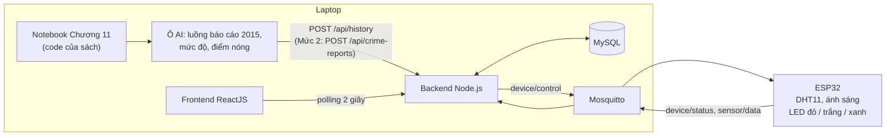

# THIẾT KẾ DEMO – TÍCH HỢP CHƯƠNG 11 VÀO HỆ THỐNG IoT CÓ SẴN
### Tận dụng project "Hệ thống giám sát, điều khiển thiết bị thông minh" (ESP32 – MQTT – Node.js – MySQL – ReactJS)

| | |
|---|---|
| **Mục tiêu** | Mô hình phân loại tội phạm của Chương 11 chạy trên laptop, đóng vai **thuật toán AI** của một hệ thống IoT thật: phát lệnh cảnh báo xuống ESP32 qua MQTT, ghi lịch sử vào MySQL, hiển thị trên web dashboard |
| **Code của sách** | `SF_crime_category_detection.ipynb`, chạy nguyên văn, chỉ thêm **1 ô** ở cuối |
| **Project tận dụng** | ESP32 + DHT11 + cảm biến ánh sáng + 3 LED; Mosquitto; Backend Node.js; MySQL; Frontend ReactJS |
| **Phần cứng mới** | **Không cần** (tùy chọn: một module còi) |
| **Bám theo sách** | Phân loại tội phạm SF (trang 332–336), Smart policing (326–327), Array of Things Chicago (332), kiến trúc nền tảng IoT 9 thành phần (328–329) |

---

## 0. Tận dụng những gì từ project có sẵn

| Thành phần của project | Dùng lại trong demo thế nào | Cần sửa project? |
|---|---|---|
| ESP32 với 3 LED: đỏ (GPIO25), trắng (GPIO18), xanh (GPIO19) | Đèn báo mức độ của từng báo cáo sự cố: đỏ / vàng (dùng LED trắng) / xanh | Không |
| DHT11, cảm biến ánh sáng, topic `sensor/data`, bảng `sensors` và `data_sensor` | Một **nút cảm biến môi trường** giống dự án Array of Things ở Chicago (sách trang 332). Bảng `sensors` ứng với khái niệm *sensor*, bảng `data_sensor` ứng với khái niệm *observation* trong sách | Không |
| Mosquitto, topic `device/control` và `device/status` | Đường truyền lệnh cảnh báo từ AI xuống ESP32 | Không |
| API `POST /api/history`, bảng `action_history` (PENDING → SUCCESS / FAILED) | AI gửi lệnh bật / tắt đèn qua **đúng API này**, nên mọi cảnh báo được ghi lịch sử | Không |
| Dashboard React (thẻ LED, cập nhật mỗi 2 giây) | Hiển thị đèn cảnh báo đổi trạng thái theo thời gian thực | Không (Mức 1), thêm trang (Mức 2) |
| Trang "Lịch sử hoạt động" | Xem toàn bộ lệnh do AI phát ra, kèm trạng thái | Không |
| Cảnh báo mất kết nối (quá 6 giây) | Backend từ chối lệnh khi ESP32 offline, nên AI không gửi lệnh "vào khoảng không" | Không |
| CSDL cho phép `action_history.user_id = NULL` (thao tác tự động) | Ghi nhận lệnh do AI phát, không phải do người bấm | Tùy cách backend gán `user_id` |

---

## 1. Kiến trúc tổng thể



**Hệ thống phủ đủ 9 thành phần kiến trúc IoT mà sách đề ra (trang 328–329):**

| Thành phần trong sách | Trong demo |
|---|---|
| Mạng thiết bị thông minh (cảm biến, cơ cấu chấp hành) | ESP32 với DHT11, cảm biến ánh sáng, 3 LED |
| Cổng kết nối hiện trường / đám mây | Wi-Fi của ESP32 và MQTT broker Mosquitto |
| Bộ xử lý dữ liệu luồng | MQTT bridge của backend (subscribe `sensor/data`, `device/status`) |
| Hồ dữ liệu | Bộ 878.049 báo cáo tội phạm SF trên laptop |
| Kho dữ liệu | MySQL: `data_sensor`, `action_history` (Mức 2: thêm `crime_reports`) |
| Công cụ phân tích và trực quan hóa | Dashboard React, biểu đồ Recharts (Mức 2: biểu đồ điểm nóng) |
| Thuật toán AI | Mô hình hồi quy logistic huấn luyện bằng code của sách |
| Ứng dụng điều khiển | Luồng điều khiển của backend: `action_history` → `device/control` → phản hồi `device/status` |
| Ứng dụng cho người dùng | Web app |

---

## 2. Ba mức triển khai

| Mức | Nội dung | Sửa project IoT | Công sức |
|---|---|---|---|
| **1** | AI phân loại báo cáo và bật đèn cảnh báo qua API có sẵn | **Không sửa gì** | Thấp |
| **2** | Lưu báo cáo đã phân loại; thêm trang "Cảnh báo an ninh" và biểu đồ **điểm nóng** theo quận | Thêm 1 bảng, 3 API, 1 trang web | Trung bình |
| **3** | Còi kêu khi gặp mức đỏ | Thêm 1 thiết bị vào bảng `devices`, vài dòng firmware | Thấp |

Mỗi mức chạy được độc lập. Ô code AI ở mục 3 dùng chung cho cả ba mức, chỉ cần bật các tùy chọn tương ứng.

---

## 3. Mức 1 – AI điều khiển đèn qua API có sẵn

### 3.1. Mức độ và đèn tương ứng

| Mức | Loại tội phạm | Đèn (deviceId) |
|---|---|---|
| `R` – đỏ | ASSAULT, ROBBERY, KIDNAPPING, SEX OFFENSES FORCIBLE, WEAPON LAWS, ARSON | LED đỏ (1) |
| `Y` – vàng | LARCENY/THEFT, VEHICLE THEFT, BURGLARY, VANDALISM, STOLEN PROPERTY, FRAUD, DRUG/NARCOTIC, DRIVING UNDER THE INFLUENCE | LED trắng (2). Có thể thay bằng LED vàng, giữ nguyên chân GPIO18 |
| `G` – xanh | Các loại còn lại | LED xanh (3) |

**Chỉ gửi lệnh khi mức độ thay đổi:** tắt đèn cũ, bật đèn mới, tức tối đa 2 lệnh cho mỗi báo cáo. Nhờ vậy trang lịch sử không bị ngập lệnh trùng.

### 3.2. Ô thêm vào cuối notebook

Cài một lần trong môi trường `spark-ch11`: `pip install requests`. Chạy backend, broker, frontend và ESP32 của project như bình thường trước khi chạy ô này.

```python
import time, requests
from collections import Counter
from pyspark.sql.functions import year

BACKEND = "http://localhost:3000"   # địa chỉ Backend Node.js của project IoT (sửa theo máy)
LED = {"R": 1, "Y": 2, "G": 3}      # deviceId: 1 = LED đỏ, 2 = LED trắng (mức vàng), 3 = LED xanh
COI = None                          # Mức 3: đặt 4 nếu đã thêm còi vào bảng devices
GUI_BAO_CAO = False                 # Mức 2: đặt True khi backend đã có API /api/crime-reports
NGHI = 4                            # số giây giữa hai báo cáo

labels = pipelineFit.stages[3].labels
RED = {"ASSAULT", "ROBBERY", "KIDNAPPING", "SEX OFFENSES FORCIBLE", "WEAPON LAWS", "ARSON"}
YELLOW = {"LARCENY/THEFT", "VEHICLE THEFT", "BURGLARY", "VANDALISM", "STOLEN PROPERTY",
          "FRAUD", "DRUG/NARCOTIC", "DRIVING UNDER THE INFLUENCE"}

# Luồng báo cáo: ~70 báo cáo năm 2015, phân loại bằng pipeline + mô hình của sách, xếp theo thời gian
raw = spark.read.format("csv").options(header="true", inferschema="true").load("sf_crime_dataset.csv")
stream = raw.filter(year("Dates") == 2015).sample(False, 0.003, seed=7)
stream = model.transform(pipelineFit.transform(stream)).orderBy("Dates")
rows = stream.select("Dates", "PdDistrict", "Descript", "Category", "prediction", "probability").collect()

def dieu_khien(device_id, action):
    """Gửi lệnh qua API có sẵn: action_history PENDING -> device/control -> ESP32 -> device/status."""
    r = requests.post(f"{BACKEND}/api/history", json={"deviceId": device_id, "action": action}, timeout=5)
    r.raise_for_status()
    time.sleep(1)                   # chờ ESP32 thực thi và phản hồi

for d in LED.values():              # bắt đầu với cả 3 đèn tắt
    dieu_khien(d, "OFF")

hot = Counter()
dang_sang = None
for r in rows:
    k = int(r["prediction"]); pred = labels[k]; p = round(100 * float(r["probability"][k]))
    level = "R" if pred in RED else "Y" if pred in YELLOW else "G"
    if level != "G":
        hot[r["PdDistrict"]] += 1
    if level != dang_sang:                          # chỉ gửi lệnh khi mức độ thay đổi
        if dang_sang:
            dieu_khien(LED[dang_sang], "OFF")
        dieu_khien(LED[level], "ON")
        dang_sang = level
    if level == "R" and COI:                        # Mức 3: còi kêu khoảng 1 giây
        dieu_khien(COI, "ON")
        dieu_khien(COI, "OFF")
    if GUI_BAO_CAO:                                 # Mức 2: lưu báo cáo đã phân loại
        requests.post(f"{BACKEND}/api/crime-reports", json={
            "reportTime": str(r["Dates"]), "district": r["PdDistrict"], "description": r["Descript"],
            "actualCategory": r["Category"], "predictedCategory": pred, "probability": p, "level": level,
        }, timeout=5).raise_for_status()
    print(f"{r['Dates']}  {r['PdDistrict']:10} {r['Descript'][:35]:35} | dự đoán: {pred} ({p}%) | mức {level}")
    time.sleep(NGHI)
print("Điểm nóng:", hot.most_common(3))
```

> Báo cáo năm 2015 được **phát lại** để minh họa luồng dữ liệu. Một phần đã nằm trong tập huấn luyện, nên độ chính xác chính thức của mô hình vẫn là kết quả ở ô [15] của sách.

---

## 4. Mức 2 – Lưu và hiển thị báo cáo trên web

### 4.1. Bảng mới trong MySQL

Kích thước cột được đặt theo dữ liệu thật: mô tả dài nhất 73 ký tự, tên loại dài nhất 27 ký tự, tên quận dài nhất 10 ký tự (có 10 quận).

```sql
CREATE TABLE crime_reports (
  report_id          INT PRIMARY KEY AUTO_INCREMENT,
  report_time        DATETIME NOT NULL,          -- thời điểm xảy ra (cột Dates)
  district           VARCHAR(20) NOT NULL,       -- quận cảnh sát (cột PdDistrict)
  description        VARCHAR(100) NOT NULL,      -- mô tả vụ việc (cột Descript)
  actual_category    VARCHAR(40),                -- loại thật (cột Category)
  predicted_category VARCHAR(40) NOT NULL,       -- loại do mô hình của sách dự đoán
  probability        TINYINT,                    -- xác suất dự đoán (%)
  level              ENUM('R', 'Y', 'G') NOT NULL,
  created_at         DATETIME DEFAULT CURRENT_TIMESTAMP,
  INDEX idx_district_level (district, level)
);
```

### 4.2. API mới

| Method | Endpoint | Request | Chức năng |
|---|---|---|---|
| POST | `/api/crime-reports` | Body: `reportTime, district, description, actualCategory, predictedCategory, probability, level` | Lưu một báo cáo đã phân loại (ô AI gọi) |
| GET | `/api/crime-reports` | Query: `keyword?, level?, district?, page?, limit?` | Tìm kiếm, lọc, phân trang (giống `/api/data-sensor`) |
| GET | `/api/crime-reports/hotspots` | Không có | Top 5 quận có nhiều báo cáo mức đỏ và vàng nhất |

Mã mẫu dưới đây giả định backend dùng **Express** và **mysql2** (dạng promise). Nếu backend của bạn tổ chức khác, chỉ cần giữ phần câu SQL và kiểm tra dữ liệu.

```js
// routes/crimeReports.js – trong app chính: app.use("/api", require("./routes/crimeReports"));
const express = require("express");
const db = require("../db");                 // pool mysql2/promise đang dùng cho các API khác
const router = express.Router();
const LEVELS = ["R", "Y", "G"];

router.post("/crime-reports", async (req, res) => {
  const b = req.body;
  if (!b.district || !b.description || !b.predictedCategory || !LEVELS.includes(b.level))
    return res.status(400).json({ message: "Thiếu hoặc sai dữ liệu" });
  try {
    const [r] = await db.query(
      `INSERT INTO crime_reports (report_time, district, description, actual_category,
                                  predicted_category, probability, level)
       VALUES (?, ?, ?, ?, ?, ?, ?)`,
      [b.reportTime, b.district, b.description, b.actualCategory, b.predictedCategory, b.probability, b.level]);
    res.status(201).json({ reportId: r.insertId });
  } catch (e) { res.status(500).json({ message: e.message }); }
});

router.get("/crime-reports", async (req, res) => {
  const page = Math.max(parseInt(req.query.page) || 1, 1);
  const limit = Math.min(Math.max(parseInt(req.query.limit) || 10, 1), 100);
  const where = [], params = [];
  if (req.query.keyword) {
    where.push("(description LIKE ? OR predicted_category LIKE ?)");
    params.push(`%${req.query.keyword}%`, `%${req.query.keyword}%`);
  }
  if (req.query.level) { where.push("level = ?"); params.push(req.query.level); }
  if (req.query.district) { where.push("district = ?"); params.push(req.query.district); }
  const w = where.length ? "WHERE " + where.join(" AND ") : "";
  try {
    const [[{ total }]] = await db.query(`SELECT COUNT(*) AS total FROM crime_reports ${w}`, params);
    const [rows] = await db.query(
      `SELECT * FROM crime_reports ${w} ORDER BY report_id DESC LIMIT ? OFFSET ?`,
      [...params, limit, (page - 1) * limit]);
    res.json({ data: rows, page, limit, total });
  } catch (e) { res.status(500).json({ message: e.message }); }
});

router.get("/crime-reports/hotspots", async (req, res) => {
  try {
    const [rows] = await db.query(
      `SELECT district, COUNT(*) AS total FROM crime_reports
       WHERE level IN ('R', 'Y') GROUP BY district ORDER BY total DESC LIMIT 5`);
    res.json(rows);
  } catch (e) { res.status(500).json({ message: e.message }); }
});

module.exports = router;
```

### 4.3. Frontend

| Vị trí | Thêm gì | Làm theo mẫu có sẵn |
|---|---|---|
| Dashboard (Trang chủ) | Thẻ **"Cảnh báo an ninh mới nhất"**: loại tội phạm, quận, xác suất, viền màu theo mức. Lấy từ `GET /api/crime-reports?page=1&limit=1` | Các thẻ cảm biến, cùng cơ chế polling 2 giây |
| Taskbar | Mục mới **"Cảnh báo an ninh"** | Mục "Dữ liệu cảm biến" |
| Trang "Cảnh báo an ninh" | Bảng gồm các cột ID, thời gian, quận, mô tả, loại dự đoán, xác suất, mức (badge đỏ / vàng / xanh). Có tìm kiếm, lọc theo mức và theo quận, phân trang | Trang "Dữ liệu cảm biến"; badge giống cột trạng thái của "Lịch sử hoạt động" |
| Trang "Cảnh báo an ninh" | **Biểu đồ cột điểm nóng** từ `GET /api/crime-reports/hotspots` | Recharts, đang dùng cho biểu đồ cảm biến |

Biểu đồ điểm nóng với Recharts:

```jsx
<BarChart width={500} height={250} data={hotspots}>
  <XAxis dataKey="district" />
  <YAxis allowDecimals={false} />
  <Tooltip />
  <Bar dataKey="total" name="Số vụ mức đỏ + vàng" fill="#e53935" />
</BarChart>
```

---

## 5. Mức 3 – Còi báo động (tùy chọn)

1. **Phần cứng**: module còi 3 chân. VCC → 3V3, GND → GND, I/O → **GPIO32** (chân đang trống).
2. **CSDL**: `INSERT INTO devices (device_id, device_name, status) VALUES (4, 'Còi báo động', 'OFF');`
3. **Firmware**: thêm vào đúng các chỗ tương ứng trong code ESP32 hiện có.
   ```cpp
   #define BUZZER_PIN 32                       // khai báo cùng các LED

   pinMode(BUZZER_PIN, OUTPUT);                // trong setup()
   digitalWrite(BUZZER_PIN, LOW);

   // trong mqttCallback(), phần "1. BẬT/TẮT LED", thêm vào chuỗi else if:
   else if (deviceId == 4 && command == "ON")  digitalWrite(BUZZER_PIN, HIGH);
   else if (deviceId == 4 && command == "OFF") digitalWrite(BUZZER_PIN, LOW);

   // trong phần "2. ĐỌC TRẠNG THÁI GPIO", thêm vào chuỗi else if:
   else if (deviceId == 4) statusStr = digitalRead(BUZZER_PIN) == HIGH ? "ON" : "OFF";
   ```
4. **Ô AI**: đặt `COI = 4`.

---

## 6. Kiểm chứng đã làm trên máy của nhóm

| Nội dung | Kết quả |
|---|---|
| Ô AI ở mục 3.2, Mức 1 (chạy nguyên văn sau notebook của sách, với backend giả lập) | Chạy không lỗi: 72 báo cáo, 86 lệnh qua `/api/history` (3 lệnh tắt ban đầu, 83 lệnh khi mức độ đổi). Mọi lệnh có `deviceId` là số nguyên và `action` là ON / OFF |
| Ô AI, bật đủ Mức 2 và Mức 3 | Thêm 20 lệnh còi cho 10 báo cáo mức đỏ, và 72 báo cáo gửi tới `/api/crime-reports`. Dữ liệu vừa kích thước các cột ở mục 4.1 |
| Điểm nóng cuối luồng | SOUTHERN 10 vụ, NORTHERN 7, CENTRAL 7 |
| Mã Express ở mục 4.2 (chạy với Node.js 22, Express và CSDL giả lập) | Cú pháp hợp lệ. Cả 3 API trả đúng mã 201 / 400 / 200 / 500. Số dấu `?` khớp số tham số ở mọi câu SQL. Phân trang mặc định trang 1, 10 bản ghi; tối đa 100 bản ghi |

*Chưa thử: chạy với backend, MySQL, broker và ESP32 thật của project; câu SQL chưa chạy trên MySQL thật.*

---

## 7. Kịch bản demo

| Bước | Thao tác | Lời thuyết minh gợi ý |
|---|---|---|
| 1 | Mở dashboard của project: nhiệt độ, độ ẩm, ánh sáng cập nhật mỗi 2 giây | "ESP32 của nhóm là một nút cảm biến môi trường, giống các nút của dự án Array of Things ở Chicago mà sách giới thiệu." |
| 2 | Chạy notebook Chương 11 (khoảng 30 giây) | "Đây là code của sách: xử lý văn bản và huấn luyện mô hình phân loại 39 loại tội phạm, đạt 97%." |
| 3 | Chạy ô AI. Mỗi 4 giây có một báo cáo; LED trên ESP32 và thẻ LED trên dashboard đổi trạng thái | "Mô hình AI phân loại từng báo cáo rồi phát lệnh cảnh báo. Lệnh đi qua đúng luồng điều khiển của hệ thống IoT: ghi lịch sử, gửi qua MQTT, ESP32 thực thi và xác nhận." |
| 4 | Mở trang "Lịch sử hoạt động": các lệnh do AI phát chuyển từ PENDING sang SUCCESS | "Mọi quyết định của AI đều được ghi lại và kiểm chứng bằng phản hồi thật từ phần cứng." |
| 5 | *(Mức 2)* Mở trang "Cảnh báo an ninh": bảng báo cáo và biểu đồ điểm nóng | "Tích lũy dữ liệu theo thời gian để tìm ra quận có nhiều vụ việc nhất: đó là phát hiện điểm nóng trong smart policing." |
| 6 | Tóm lại bằng bảng 9 thành phần ở mục 1 | "Hệ thống của nhóm có đủ 9 thành phần của một nền tảng IoT cho thành phố thông minh theo sách." |

---

## 8. Lưu ý

- **Địa chỉ backend**: sửa `BACKEND` cho đúng cổng của backend. Nếu backend và notebook cùng chạy trên laptop thì dùng `localhost`.
- **Thư viện**: cài `requests` vào môi trường `spark-ch11` trước khi chạy ô AI.
- **ESP32 offline**: backend từ chối lệnh, ô AI sẽ dừng và báo lỗi. Kiểm tra dashboard không còn báo mất kết nối trước khi chạy.
- **Thời lượng**: chạy hết 72 báo cáo mất khoảng 6 phút (4 giây mỗi báo cáo, cộng 1 giây cho mỗi lệnh). Khi thuyết trình, có thể giảm `NGHI` xuống 2, hoặc bấm Interrupt để dừng ô sau vài chục báo cáo.
- **Lệnh dồn dập**: mỗi lệnh chờ 1 giây để ESP32 phản hồi. Nếu backend không nhận lệnh mới khi lệnh trước của cùng thiết bị còn PENDING, tăng thời gian chờ trong hàm `dieu_khien`.
- **Đèn thay đổi trên dashboard**: trạng thái LED trên web vẫn là trạng thái thiết bị đã xác nhận, đúng thiết kế PENDING → SUCCESS của project.
- **Bảo mật**: không đưa mật khẩu Wi-Fi và tài khoản MQTT vào báo cáo hay repo GitHub.
- **Ghi nguồn**: nên ghi rõ trong báo cáo rằng nền tảng IoT (phần cứng, MQTT, backend, frontend) được tái sử dụng từ project môn "IoT và ứng dụng".

---

## 9. Hướng mở rộng (cho tiểu luận cuối kỳ)

1. **Chuyển logic cảnh báo vào backend**: ô AI chỉ gửi báo cáo. Backend tự quyết định mức độ và bật đèn, ghi `action_history.user_id = NULL` cho thao tác tự động, đúng như CSDL đã dự trù.
2. **Đèn đường thông minh** (trang 327): dùng dữ liệu ánh sáng của nút cảm biến để tự bật đèn khi trời tối, giống hệ thống CitySense.
3. **AI chạy ngay trên ESP32**: xuất mô hình của sách ra file khoảng 130 KB rồi nạp vào ESP32. Nhóm đã kiểm chứng cách tính này cho kết quả trùng Spark trên toàn bộ 879 mô tả.
4. **Dự báo điểm nóng**: huấn luyện mô hình dự đoán loại tội phạm theo thời gian và quận (`Dates`, `PdDistrict`, `X`, `Y`), rồi kết hợp với dữ liệu môi trường của các nút cảm biến.
