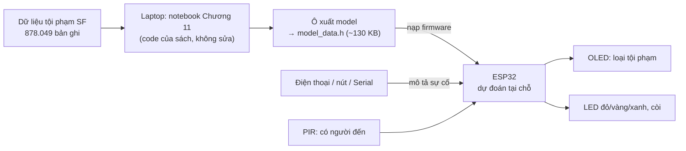
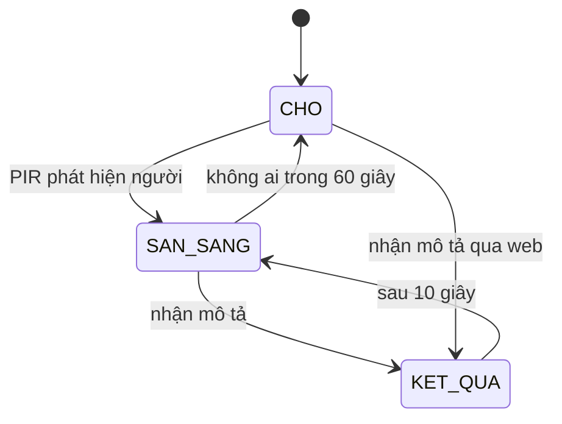

# THIẾT KẾ DEMO PHẦN CỨNG – TRẠM BÁO CÁO SỰ CỐ THÔNG MINH
### Chương 11 – AI for Smart Cities IoT

| | |
|---|---|
| **Mục tiêu** | Một trạm báo cáo sự cố đặt ngoài phố: người dân nhập mô tả sự việc, trạm **tự phân loại loại tội phạm ngay trên ESP32** bằng mô hình huấn luyện từ code của sách, rồi báo mức độ bằng màn hình, đèn và còi |
| **Code của sách** | `SF_crime_category_detection.ipynb` – mục "Detecting crime using San Francisco crime data" (trang 332–336 bản in) |
| **Liên hệ lý thuyết** | Smart policing (trang 326–327); kiến trúc nền tảng IoT 9 thành phần (trang 328–329) |
| **Phần cứng** | ESP32, cảm biến chuyển động PIR, màn OLED, 3 LED, còi, nút nhấn |
| **Không cần** | Raspberry Pi, router Wi-Fi, Internet, máy chủ |

---

## 1. Ý tưởng và kiến trúc

Demo chia thành hai giai đoạn, đúng mô hình *huấn luyện trên máy mạnh – triển khai xuống thiết bị biên* (edge AI):



| Giai đoạn | Thiết bị | Việc làm |
|---|---|---|
| **1. Huấn luyện** | Laptop | Chạy notebook của sách: pipeline xử lý văn bản và hồi quy logistic. Thêm **một ô cuối** xuất mô hình đã học |
| **2. Triển khai** | ESP32 | Nạp mô hình vào bộ nhớ flash, lặp lại đúng các bước dự đoán của pipeline để phân loại mô tả do người dùng nhập |

---

## 2. Chức năng

| Trạng thái | Điều kiện vào | Hiển thị |
|---|---|---|
| **CHỜ** | Khởi động, hoặc không có ai trong 60 giây | OLED tắt, đèn tắt (tiết kiệm điện) |
| **SẴN SÀNG** | PIR phát hiện người | OLED: "Moi bao su co" |
| **KẾT QUẢ** | Nhận được mô tả (từ web, nút hoặc Serial) | OLED: loại tội phạm và xác suất; bật LED theo mức độ; còi kêu nếu mức đỏ. Giữ 10 giây rồi quay về SẴN SÀNG |



**Mức độ** (nhóm có thể điều chỉnh):

| Mức | Loại tội phạm | LED | Còi |
|---|---|---|---|
| **Đỏ** – xâm hại con người | ASSAULT, ROBBERY, KIDNAPPING, SEX OFFENSES FORCIBLE, WEAPON LAWS, ARSON | Đỏ | Có |
| **Vàng** – tài sản, ma túy, giao thông | LARCENY/THEFT, VEHICLE THEFT, BURGLARY, VANDALISM, STOLEN PROPERTY, FRAUD, DRUG/NARCOTIC, DRIVING UNDER THE INFLUENCE | Vàng | Không |
| **Xanh** – còn lại | NON-CRIMINAL, MISSING PERSON, WARRANTS, SUSPICIOUS OCC, OTHER OFFENSES, … | Xanh | Không |

---

## 3. Linh kiện

| # | Linh kiện | Số lượng | Vai trò |
|---|---|---|---|
| 1 | ESP32 DevKit | 1 | Bộ điều khiển, chạy mô hình AI, phát Wi-Fi |
| 2 | Cảm biến chuyển động PIR HC-SR501 | 1 | Phát hiện người đến trạm |
| 3 | Màn OLED SSD1306 0.96" I2C | 1 | Hiện kết quả phân loại |
| 4 | LED đỏ, vàng, xanh và 3 điện trở 220 Ω | 1 bộ | Báo mức độ |
| 5 | Module còi 3 chân (có sẵn transistor) | 1 | Cảnh báo mức đỏ |
| 6 | Nút nhấn | 1 | Gửi mô tả mẫu (dự phòng) |
| 7 | Breadboard, dây cắm, cáp USB | – | Lắp mạch, cấp nguồn |

---

## 4. Nối dây

| Linh kiện | Chân linh kiện | Chân ESP32 |
|---|---|---|
| PIR HC-SR501 | VCC / GND / OUT | VIN (5V) / GND / **GPIO34** |
| OLED SSD1306 | VCC / GND / SDA / SCL | 3V3 / GND / **GPIO21** / **GPIO22** |
| LED đỏ / vàng / xanh (mỗi LED qua điện trở 220 Ω, chân ngắn về GND) | Chân dài | **GPIO25** / **GPIO26** / **GPIO27** |
| Module còi | VCC / GND / I/O | 3V3 / GND / **GPIO32** |
| Nút nhấn | Chân 1 / Chân 2 | **GPIO33** (bật pull-up nội) / GND |

**Ghi chú:**
- **GPIO34** chỉ đọc được tín hiệu vào, phù hợp cho PIR. PIR chạy bằng nguồn 5V nhưng tín hiệu ra là 3,3V, nên an toàn cho ESP32.
- Nhiều module còi **kích ở mức thấp** (LOW là kêu). Thử trước rồi đảo logic trong code nếu cần.

---

## 5. Thiết kế phần mềm

### 5.1. Laptop – xuất mô hình từ notebook của sách

Sau khi chạy hết notebook, thêm một ô cuối lấy mô hình **từ đúng các biến của sách** (`pipelineFit`, `model`) và ghi ra file C:

```python
vocab  = pipelineFit.stages[2].vocabulary        # 809 từ của CountVectorizer
labels = pipelineFit.stages[3].labels            # 39 loại, theo thứ tự của StringIndexer
W = model.coefficientMatrix.toArray()            # 39 x 809 trọng số
b = model.interceptVector.toArray()              # 39 hệ số chặn
# -> ghi ra model_data.h: VOCAB[], LABELS[], STOP_WORDS[], W[39][809] (float32), B[39]
```

| Thành phần trong `model_data.h` | Kích thước |
|---|---|
| Trọng số `W` (float32) | 123,2 KB |
| Danh sách từ, tên loại, từ dừng, hệ số chặn | khoảng 7 KB |
| **Tổng** | **khoảng 130 KB**, khai báo `const` để nằm trong flash, không tốn RAM |

### 5.2. ESP32 – thuật toán dự đoán

ESP32 thực hiện lại đúng phần dự đoán của pipeline trong sách:

| Bước trong pipeline của sách | Thực hiện trên ESP32 |
|---|---|
| `RegexTokenizer(pattern="\\W")` | Đổi chữ thường; tách từ tại mọi ký tự không phải `a–z`, `0–9`, `_` |
| `StopWordsRemover` (7 từ dừng của sách) | Bỏ các từ `http, https, amp, rt, t, c, the` |
| `CountVectorizer` (809 từ) | Tra từng từ trong `VOCAB`, đếm số lần xuất hiện; bỏ qua từ không có trong từ vựng |
| `LogisticRegressionModel` | Với mỗi loại k: `z[k] = B[k] + Σ W[k][j] × đếm[j]` (chỉ cộng các từ có mặt); xác suất = softmax(z); kết quả = loại có z lớn nhất |

```
du_doan(mo_ta):
    tu  ← tach_tu(chu_thuong(mo_ta)), bỏ từ dừng
    z   ← B                                  (39 giá trị)
    với mỗi từ trong tu:
        j ← vị trí của từ trong VOCAB; nếu không có thì bỏ qua
        với k = 0..38:  z[k] += W[k][j]
    p   ← softmax(z)
    trả về LABELS[argmax z], p[argmax z]
```

Mỗi lần dự đoán chỉ tốn vài trăm phép cộng và vài nghìn lần so sánh chuỗi, nên chạy gần như tức thì trên ESP32.

### 5.3. Ba cách nhập mô tả

| Cách | Mô tả |
|---|---|
| **Web (chính)** | ESP32 tự phát Wi-Fi tên `Tram-Bao-Su-Co` (mật khẩu ít nhất 8 ký tự). Điện thoại kết nối vào, mở `192.168.4.1`, gõ mô tả rồi bấm Gửi. Trang trả về loại tội phạm, xác suất và 3 loại có khả năng cao nhất |
| **Nút nhấn (dự phòng)** | Mỗi lần bấm gửi lần lượt một mô tả mẫu có sẵn trong code (danh sách ở mục 7) |
| **Serial Monitor (dự phòng)** | 115200 baud; gõ một dòng mô tả, ESP32 in kết quả |

### 5.4. Hiển thị trên OLED (128×64, chữ cỡ 1, tối đa 21 ký tự mỗi dòng)

```
TRAM BAO SU CO
> BATTERY
ASSAULT
p = 42%   MUC: DO
```

### 5.5. Tự kiểm tra khi khởi động

Ô xuất mô hình ghi thêm vào `model_data.h` khoảng 20 mô tả lấy từ dữ liệu, kèm loại mà **Spark** đã dự đoán cho chúng. Khi khởi động, ESP32 tự dự đoán lại và in ra Serial, ví dụ `Self-test: 20/20 khop voi Spark`. Kết quả này chứng minh trước lớp rằng ESP32 cho cùng kết quả với code của sách.

---

## 6. Kiểm chứng đã thực hiện trên máy của nhóm

| Kiểm chứng | Kết quả |
|---|---|
| Cách tính thủ công (như ESP32) so với Spark, trên 813 mô tả khác nhau của tập kiểm tra | **Trùng 100%** |
| Trọng số float32 (như trên ESP32) so với tính chuẩn, trên toàn bộ 879 mô tả của dữ liệu | **Không mô tả nào đổi kết quả** |
| Nén trọng số xuống float16 (69 KB) | Không mô tả nào đổi kết quả (phương án dự phòng nếu thiếu bộ nhớ) |
| Nén trọng số xuống int8 (38 KB) | **2 mô tả bị đổi kết quả**, vì vậy không dùng |
| Thời gian dự đoán bằng Spark trên laptop | Khoảng 11 giây mỗi lần, lý do không dùng Spark khi demo |

*Chưa kiểm chứng: kích thước chương trình sau khi biên dịch và tốc độ trên ESP32 thật.*

---

## 7. Kiểm thử và kịch bản demo

Các câu dưới đây đã thử với mô hình của sách, kết quả trùng Spark:

| # | Nhập | Kết quả mong đợi | Xác suất | Mức |
|---|---|---|---|---|
| 1 | BATTERY | ASSAULT | 42% | Đỏ + còi |
| 2 | THREATS AGAINST LIFE | ASSAULT | 71% | Đỏ + còi |
| 3 | ROBBERY, ARMED WITH A GUN | ROBBERY | 59% | Đỏ + còi |
| 4 | GRAND THEFT FROM LOCKED AUTO | LARCENY/THEFT | 85% | Vàng |
| 5 | STOLEN AUTOMOBILE | VEHICLE THEFT | 56% | Vàng |
| 6 | BICYCLE THEFT | LARCENY/THEFT | 53% | Vàng |
| 7 | LOST PROPERTY | NON-CRIMINAL | 53% | Xanh |
| 8 | MISSING ADULT | MISSING PERSON | 50% | Xanh |
| 9 | WARRANT ARREST | WARRANTS | 49% | Xanh |

**Kiểm thử phần cứng:**

| Thao tác | Kết quả mong đợi |
|---|---|
| Bật nguồn | Serial in kết quả tự kiểm tra; OLED tắt (CHỜ) |
| Đi tới trước PIR | OLED hiện "Moi bao su co" |
| Bấm nút | Gửi mô tả mẫu kế tiếp, hiện kết quả |
| Rời đi hơn 60 giây | OLED và đèn tắt |

**Không nên nhập khi demo** (mô hình của sách đoán sai):
- Một từ thuộc loại hiếm, như "KIDNAPPING", "ARSON", "VANDALISM": đều ra OTHER OFFENSES.
- Câu tự do, như "PHONE STOLEN ON BUS": ra VEHICLE THEFT.
- Tiếng Việt: mô hình chỉ biết từ tiếng Anh trong biên bản cảnh sát.

---

## 8. Lưu ý

- **Partition**: khi nạp code bằng Arduino IDE, chọn Partition Scheme **"Huge APP (3MB No OTA)"**. Mô hình (130 KB) cộng Wi-Fi và web server có thể vượt dung lượng mặc định dành cho chương trình. Nếu vẫn thiếu, chuyển trọng số sang float16.
- **PIR**: HC-SR501 cần **30–60 giây khởi động** sau khi cấp điện. Vặn biến trở thời gian về nhỏ nhất, đặt jumper ở chế độ lặp lại (H).
- **Font OLED**: không có dấu tiếng Việt, nên hiện tên loại bằng tiếng Anh như trong dữ liệu.
- **Xác suất thấp là bình thường**: xác suất của mô hình sách chỉ khoảng 40–85%, do điều chuẩn mạnh (`regParam = 0.3`). Đây cũng là một điểm để nói khi thuyết trình.

---

## 9. Liên hệ với kiến trúc IoT của chương (trang 328–329)

| Thành phần trong sách | Trong demo |
|---|---|
| Thiết bị thông minh (cảm biến) | PIR phát hiện người đến trạm |
| Hồ dữ liệu, kho dữ liệu | Bộ dữ liệu 878.049 báo cáo tội phạm trên laptop |
| Thuật toán AI | Mô hình hồi quy logistic huấn luyện bằng code của sách, chạy trên ESP32 |
| Ứng dụng điều khiển | Firmware ESP32 quyết định bật đèn, còi theo mức độ |
| Cơ cấu chấp hành | LED, còi |
| Ứng dụng cho người dân | Trang web nhập mô tả trên điện thoại |
| Công cụ trực quan hóa | OLED, trang kết quả trên điện thoại |

---

## 10. Hướng mở rộng (cho tiểu luận cuối kỳ)

1. **Mô hình cải tiến**: nạp thêm mô hình `regParam = 0` (cùng kích thước) và dùng nút bấm để chuyển qua lại. Khi đó "KIDNAPPING", "ARSON" được phân loại đúng; mô hình này cũng đã kiểm tra: không mô tả nào khác kết quả tính chuẩn.
2. **Nhiều trạm nối mạng**: các trạm gửi kết quả về một máy chủ để vẽ bản đồ **điểm nóng** theo khu vực và khung giờ, đúng tinh thần smart policing.
3. **Dự đoán theo thời gian và địa điểm**: huấn luyện mô hình từ `Dates`, `PdDistrict`, `X`, `Y` thay vì mô tả, để dự báo loại sự cố có khả năng xảy ra.
4. **Đèn đường thông minh**: ghép thêm cảm biến ánh sáng và LED để mô phỏng CitySense (trang 327): đèn sáng dịu khi đường vắng, sáng tối đa khi PIR phát hiện người, và ước tính phần trăm điện tiết kiệm được.
