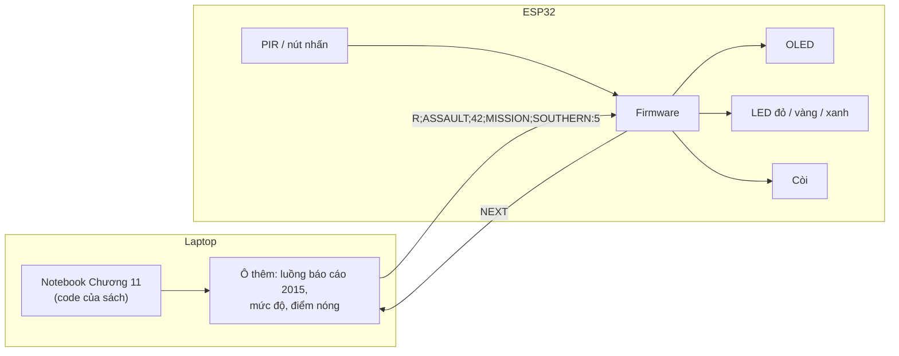

# THIẾT KẾ DEMO PHẦN CỨNG – TRẠM BÁO SỰ CỐ THÔNG MINH
### Chương 11 – AI for Smart Cities IoT (xây dựng qua 3 vòng lặp)

| | |
|---|---|
| **Mục tiêu** | Laptop chạy code phân loại tội phạm của sách; ESP32 làm thiết bị ngoài hiện trường: phát hiện người, hiển thị kết quả, cảnh báo bằng đèn và còi, và báo **điểm nóng tội phạm** theo quận |
| **Code của sách** | `SF_crime_category_detection.ipynb`, chạy nguyên văn, chỉ thêm **1 ô** ở cuối |
| **Bám theo sách** | Phân loại tội phạm (trang 332–336), Smart policing (trang 326–327), kiến trúc nền tảng IoT và quá trình cải tiến lặp (trang 328–329) |
| **Phần cứng** | ESP32, 3 LED, cảm biến chuyển động PIR, màn OLED, còi, nút nhấn |
| **Không cần** | Wi-Fi, Raspberry Pi, sửa code của sách |

---

## 0. Cách tiếp cận: cải tiến qua từng vòng lặp

Ở trang 329, sách mô tả xây dựng thành phố thông minh là **quá trình lặp**: mỗi vòng thêm một khâu xử lý, như ví dụ đèn giao thông thông minh. Demo được xây theo đúng cách đó:

| Vòng | Thêm vào | Thành phần kiến trúc IoT của sách | Mục sách liên quan | Độ khó |
|---|---|---|---|---|
| **1** | Laptop phân loại báo cáo, ESP32 bật đèn đỏ / vàng / xanh | Thuật toán AI, ứng dụng điều khiển, cơ cấu chấp hành | Phân loại tội phạm SF (332–336) | Dễ |
| **2** | Cảm biến PIR xin báo cáo khi có người đến; OLED hiện kết quả; còi cảnh báo; giao tiếp **hai chiều** | Thiết bị thông minh (cảm biến), công cụ trực quan hóa | Camera, cảm biến của Singapore (327) | Trung bình |
| **3** | Báo cáo kèm **quận và thời gian**; thống kê **điểm nóng** theo quận | Phân tích dữ liệu | Smart policing: xác định điểm nóng tội phạm (326) | Trung bình |

Mỗi vòng chạy được độc lập, nên nhóm có thể dừng ở vòng nào cũng được. Phần mềm vòng 2 và 3 dùng chung một bộ code.

---

## 1. Kiến trúc (vòng 3)



**Quy trình:**
1. Có người đến trước trạm, PIR kích hoạt, ESP32 gửi `NEXT` cho laptop.
2. Laptop lấy báo cáo kế tiếp, đã được mô hình của sách phân loại sẵn, và cập nhật thống kê điểm nóng.
3. Laptop gửi kết quả xuống ESP32.
4. ESP32 hiện kết quả lên OLED, bật đèn theo mức độ, và kêu còi nếu là mức đỏ.

---

## 2. Linh kiện và nối dây

| Linh kiện | Vòng | Chân linh kiện → chân ESP32 |
|---|---|---|
| LED đỏ / vàng / xanh, mỗi LED qua điện trở 220 Ω | 1 | Chân dài → **GPIO25** / **GPIO26** / **GPIO27**; chân ngắn → GND |
| Cảm biến chuyển động PIR HC-SR501 | 2 | VCC → VIN (5V), GND → GND, OUT → **GPIO34** |
| Màn OLED SSD1306 0.96" I2C | 2 | VCC → 3V3, GND → GND, SDA → **GPIO21**, SCL → **GPIO22** |
| Module còi 3 chân (có sẵn transistor) | 2 | VCC → 3V3, GND → GND, I/O → **GPIO32** |
| Nút nhấn (dự phòng cho PIR) | 2 | Một chân → **GPIO33**, chân kia → GND (dùng pull-up nội) |
| Cáp USB, breadboard, dây cắm | 1 | ESP32 ↔ laptop: cấp nguồn và truyền dữ liệu |

---

## 3. Giao thức laptop ⇄ ESP32 (qua cáp USB, 115200 baud)

| Chiều | Vòng | Tin nhắn | Ý nghĩa |
|---|---|---|---|
| Laptop → ESP32 | 1 | `R`, `Y` hoặc `G` | Mức đỏ / vàng / xanh |
| ESP32 → laptop | 2–3 | `NEXT` | Có người đến (PIR) hoặc bấm nút: xin báo cáo kế tiếp |
| Laptop → ESP32 | 2–3 | `R;ASSAULT;42;MISSION;SOUTHERN:5` | Mức; loại tội phạm; xác suất (%); quận xảy ra; quận điểm nóng : số vụ |

**Mức độ:**

| Mức | Loại tội phạm |
|---|---|
| `R` – đỏ, kèm còi | ASSAULT, ROBBERY, KIDNAPPING, SEX OFFENSES FORCIBLE, WEAPON LAWS, ARSON |
| `Y` – vàng | LARCENY/THEFT, VEHICLE THEFT, BURGLARY, VANDALISM, STOLEN PROPERTY, FRAUD, DRUG/NARCOTIC, DRIVING UNDER THE INFLUENCE |
| `G` – xanh | Các loại còn lại |

**Điểm nóng:** đếm số báo cáo mức đỏ và vàng theo từng quận cảnh sát. Quận có nhiều vụ nhất là điểm nóng.

---

## 4. Phần mềm trên laptop – ô thêm vào cuối notebook

Cài một lần trong môi trường `spark-ch11`: `pip install pyserial`. Các ô dưới đây **chỉ dùng lại biến của sách**: `spark`, `pipelineFit`, `model`, `predictions`.

### 4.1. Vòng 1

```python
import serial, time

esp = serial.Serial("COM3", 115200)      # đổi COM3 theo cổng của ESP32
time.sleep(2)                            # ESP32 tự khởi động lại khi mở cổng

labels = pipelineFit.stages[3].labels
RED = {"ASSAULT", "ROBBERY", "KIDNAPPING", "SEX OFFENSES FORCIBLE", "WEAPON LAWS", "ARSON"}
YELLOW = {"LARCENY/THEFT", "VEHICLE THEFT", "BURGLARY", "VANDALISM", "STOLEN PROPERTY",
          "FRAUD", "DRUG/NARCOTIC", "DRIVING UNDER THE INFLUENCE"}

rows = predictions.sample(False, 0.0002, seed=11) \
                  .select("Descript", "Category", "prediction").collect()
for r in rows:
    pred = labels[int(r["prediction"])]
    level = "R" if pred in RED else "Y" if pred in YELLOW else "G"
    print(f"{r['Descript'][:40]:40} | thật: {r['Category']:15} | dự đoán: {pred}")
    esp.write(level.encode())
    time.sleep(3)
esp.close()
```

### 4.2. Vòng 2–3

Ở bước 3, notebook của sách đã bỏ cột quận (`PdDistrict`) và thời gian (`Dates`). Vì vậy ô này đọc lại dữ liệu đầy đủ cột, chọn khoảng 70 báo cáo năm 2015, rồi cho đi qua **đúng pipeline và mô hình của sách**.

```python
import serial, time
from collections import Counter
from pyspark.sql.functions import year

PORT = "COM3"            # đổi theo cổng của ESP32
TU_DONG = False          # True: tự gửi mỗi 3 giây, không chờ cảm biến

labels = pipelineFit.stages[3].labels
RED = {"ASSAULT", "ROBBERY", "KIDNAPPING", "SEX OFFENSES FORCIBLE", "WEAPON LAWS", "ARSON"}
YELLOW = {"LARCENY/THEFT", "VEHICLE THEFT", "BURGLARY", "VANDALISM", "STOLEN PROPERTY",
          "FRAUD", "DRUG/NARCOTIC", "DRIVING UNDER THE INFLUENCE"}

# Luồng báo cáo: ~70 báo cáo năm 2015, phân loại bằng pipeline + mô hình của sách, xếp theo thời gian
raw = spark.read.format("csv").options(header="true", inferschema="true").load("sf_crime_dataset.csv")
stream = raw.filter(year("Dates") == 2015).sample(False, 0.003, seed=7)
stream = model.transform(pipelineFit.transform(stream)).orderBy("Dates")
rows = stream.select("Dates", "PdDistrict", "Descript", "Category", "prediction", "probability").collect()

esp = serial.Serial(PORT, 115200, timeout=1)
time.sleep(2)
hot = Counter()
for r in rows:
    if not TU_DONG:
        while esp.readline().strip() != b"NEXT":     # chờ PIR hoặc nút trên ESP32
            pass
    k = int(r["prediction"]); pred = labels[k]; p = round(100 * float(r["probability"][k]))
    level = "R" if pred in RED else "Y" if pred in YELLOW else "G"
    if level != "G":
        hot[r["PdDistrict"]] += 1
    top, n = hot.most_common(1)[0] if hot else ("-", 0)
    esp.write(f"{level};{pred[:21]};{p};{r['PdDistrict']};{top}:{n}\n".encode())
    print(f"{r['Dates']}  {r['PdDistrict']:10} {r['Descript'][:35]:35} | thật: {r['Category']:15} | dự đoán: {pred} ({p}%)")
    if TU_DONG:
        time.sleep(3)
esp.close()
print("Điểm nóng:", hot.most_common(3))
```

> Báo cáo năm 2015 được **phát lại** để minh họa luồng dữ liệu. Một phần trong số đó đã nằm trong tập huấn luyện, nên độ chính xác chính thức của mô hình vẫn là kết quả ở ô [15] của sách.

---

## 5. Phần mềm ESP32 (Arduino IDE)

### 5.1. Vòng 1

```cpp
const int RED = 25, YEL = 26, GRN = 27;

void setup() {
  Serial.begin(115200);
  pinMode(RED, OUTPUT); pinMode(YEL, OUTPUT); pinMode(GRN, OUTPUT);
}

void loop() {
  if (Serial.available()) {
    char c = Serial.read();
    if (c == 'R' || c == 'Y' || c == 'G') {
      digitalWrite(RED, c == 'R');
      digitalWrite(YEL, c == 'Y');
      digitalWrite(GRN, c == 'G');
    }
  }
}
```

### 5.2. Vòng 2–3

Cài hai thư viện qua Library Manager: **Adafruit SSD1306** và **Adafruit GFX Library**. Code đã được biên dịch thử với bộ ESP32 cho Arduino bản 3.3.12, Adafruit SSD1306 bản 2.5.17 và Adafruit GFX bản 1.12.6.

```cpp
// Chuong 11 - Den bao muc do su co (vong 2-3)
// Nhan tin nhan tu laptop: MUC;LOAI;XAC_SUAT;QUAN;DIEM_NONG:SO_VU   (vi du: R;ASSAULT;42;MISSION;SOUTHERN:5)
// Gui "NEXT" ve laptop khi cam bien PIR phat hien nguoi hoac khi bam nut.
#include <Wire.h>
#include <Adafruit_GFX.h>
#include <Adafruit_SSD1306.h>

const int LED_RED = 25, LED_YEL = 26, LED_GRN = 27;
const int PIN_PIR = 34, PIN_BUZ = 32, PIN_BTN = 33;
const bool BUZ_ACTIVE_LOW = false;        // doi thanh true neu coi keu khi chan o muc LOW
const unsigned long COOLDOWN_MS = 4000;   // toi thieu 4 giay giua hai lan xin bao cao

Adafruit_SSD1306 oled(128, 64, &Wire, -1);
String line;
unsigned long lastRequest = 0;
int lastPir = LOW;
bool oledOk = false;

void setLeds(char level) {
  digitalWrite(LED_RED, level == 'R');
  digitalWrite(LED_YEL, level == 'Y');
  digitalWrite(LED_GRN, level == 'G');
}

void buzzer(bool on) {
  digitalWrite(PIN_BUZ, on != BUZ_ACTIVE_LOW ? HIGH : LOW);
}

void show(const String &l1, const String &l2, const String &l3, const String &l4) {
  if (!oledOk) return;
  oled.clearDisplay();
  oled.setCursor(0, 0);  oled.print(l1);
  oled.setCursor(0, 16); oled.print(l2);
  oled.setCursor(0, 32); oled.print(l3);
  oled.setCursor(0, 48); oled.print(l4);
  oled.display();
}

void handleMessage(const String &msg) {
  int a = msg.indexOf(';');
  int b = msg.indexOf(';', a + 1);
  int c = msg.indexOf(';', b + 1);
  int d = msg.indexOf(';', c + 1);
  if (a != 1 || b < 0 || c < 0 || d < 0) return;          // sai dinh dang thi bo qua

  char level = msg.charAt(0);
  String category = msg.substring(a + 1, b);
  String prob = msg.substring(b + 1, c);
  String district = msg.substring(c + 1, d);
  String hotspot = msg.substring(d + 1);
  const char *name = level == 'R' ? "DO" : level == 'Y' ? "VANG" : "XANH";

  setLeds(level);
  show(category, "p=" + prob + "%  MUC: " + name, "Quan: " + district, "Diem nong: " + hotspot);
  if (level == 'R') { buzzer(true); delay(300); buzzer(false); }
}

void requestNext() {
  if (millis() - lastRequest < COOLDOWN_MS) return;
  lastRequest = millis();
  Serial.println("NEXT");
}

void setup() {
  Serial.begin(115200);
  pinMode(LED_RED, OUTPUT); pinMode(LED_YEL, OUTPUT); pinMode(LED_GRN, OUTPUT);
  pinMode(PIN_BUZ, OUTPUT); buzzer(false);
  pinMode(PIN_PIR, INPUT);
  pinMode(PIN_BTN, INPUT_PULLUP);

  oledOk = oled.begin(SSD1306_SWITCHCAPVCC, 0x3C);
  if (!oledOk) Serial.println("Khong tim thay OLED");
  oled.setTextSize(1);
  oled.setTextColor(SSD1306_WHITE);
  show("TRAM BAO SU CO", "Chuong 11 - SF crime", "Cho bao cao...", "");
}

void loop() {
  int pir = digitalRead(PIN_PIR);
  if (pir == HIGH && lastPir == LOW) requestNext();       // co nguoi moi xuat hien
  lastPir = pir;
  if (digitalRead(PIN_BTN) == LOW) requestNext();          // nut nhan du phong

  while (Serial.available()) {
    char ch = Serial.read();
    if (ch == '\n') {
      line.trim();
      if (line.length() > 0) handleMessage(line);
      line = "";
    } else if (line.length() < 80) {
      line += ch;
    }
  }
}
```

Màn OLED hiển thị 4 dòng, ví dụ:

```
LARCENY/THEFT
p=85%  MUC: VANG
Quan: NORTHERN
Diem nong: NORTHERN:2
```

---

## 6. Kiểm chứng đã làm trên máy của nhóm

| Nội dung | Kết quả |
|---|---|
| Chạy nguyên văn ô 4.1 và 4.2 sau notebook của sách, với cổng USB giả lập | Cả hai chạy không lỗi; gửi đủ 51 và 72 tin nhắn đúng định dạng |
| Vòng 1: lấy báo cáo từ `predictions` | 51 báo cáo trong 1–3 giây; đúng 51/51; đỏ 8, vàng 23, xanh 20 |
| Vòng 2–3: luồng báo cáo năm 2015 | 72 báo cáo (trong 27.584 báo cáo năm 2015), chuẩn bị trong 2–13 giây tùy lần chạy; đúng 70/72; đỏ 10, vàng 36, xanh 26 |
| Vòng 3: điểm nóng cuối luồng | SOUTHERN 10 vụ, NORTHERN 7, CENTRAL 7, PARK 4 |
| Độ dài tin nhắn dài nhất | 42 ký tự (ESP32 nhận tối đa 80) |
| Biên dịch code ESP32 (board ESP32 Dev Module) | Cả hai đoạn code ở mục 5 biên dịch **không lỗi, không cảnh báo**. Vòng 2–3 dùng 308 KB (23%) bộ nhớ chương trình và 23,7 KB (7%) RAM, nên phân vùng bộ nhớ mặc định là đủ |

*Chưa thử: chạy trên ESP32 thật và gửi dữ liệu qua cáp USB.*

---

## 7. Kịch bản demo

| Vòng | Thao tác | Lời thuyết minh gợi ý |
|---|---|---|
| 1 | Chạy notebook, rồi chạy ô 4.1. Đèn đổi màu mỗi 3 giây | "Code của sách phân loại từng báo cáo, gửi lệnh cảnh báo xuống thiết bị." |
| 2 | Chạy ô 4.2, rồi bước tới trước cảm biến PIR. OLED hiện kết quả; gặp mức đỏ thì còi kêu | "Thiết bị ngoài hiện trường có cảm biến. Khi phát hiện người, nó xin dữ liệu, và hiển thị kết quả AI cho người dân." |
| 3 | Chỉ vào dòng "Diem nong" trên OLED và bảng in trên laptop | "Hệ thống tích lũy dữ liệu theo thời gian để tìm ra quận có nhiều vụ việc nhất: đây chính là phát hiện điểm nóng trong smart policing mà sách mô tả." |

---

## 8. Lưu ý

- **Serial Monitor**: đóng Serial Monitor của Arduino IDE trước khi chạy ô trên laptop, vì một cổng USB chỉ một chương trình dùng được. Tìm tên cổng ở Tools → Port, hoặc trong Device Manager.
- **PIR HC-SR501**: cần 30–60 giây khởi động sau khi cấp điện. Vặn biến trở thời gian về nhỏ nhất, đặt jumper ở chế độ lặp lại (H). ESP32 chỉ xin báo cáo tối đa mỗi 4 giây một lần (`COOLDOWN_MS`).
- **Còi**: nếu còi kêu ngược (kêu khi đáng lẽ tắt), đổi `BUZ_ACTIVE_LOW` thành `true`.
- **Ô vòng 2–3 đứng yên**: ô này chờ tín hiệu từ ESP32. Nếu chưa lắp PIR hay nút, đặt `TU_DONG = True`.
- **Vì sao phát lại báo cáo có sẵn mà không gõ câu mới**: dự đoán từng câu mới bằng Spark mất khoảng 11 giây mỗi lần trên máy của nhóm.

---

## 9. Liên hệ với kiến trúc IoT của chương (trang 328–329)

| Thành phần trong sách | Trong demo | Vòng |
|---|---|---|
| Thiết bị thông minh (cảm biến) | PIR phát hiện người đến trạm | 2 |
| Hồ dữ liệu, kho dữ liệu | Bộ dữ liệu 878.049 báo cáo trên laptop | 1 |
| Thuật toán AI | Mô hình hồi quy logistic của sách | 1 |
| Công cụ phân tích và trực quan hóa | Thống kê điểm nóng; OLED và bảng in trên laptop | 2–3 |
| Ứng dụng điều khiển | Ô thêm: quyết định mức độ, gửi lệnh | 1 |
| Cơ cấu chấp hành | Đèn, còi | 1–2 |

---

## 10. Hướng mở rộng (cho tiểu luận cuối kỳ)

1. **Bỏ dây USB**: ESP32 nhận lệnh qua Wi-Fi, vào vai cổng kết nối hiện trường trong kiến trúc của sách.
2. **AI chạy ngay trên ESP32**: xuất mô hình của sách ra file khoảng 130 KB rồi nạp vào ESP32. Nhóm đã kiểm chứng: cách tính trên ESP32 cho kết quả trùng Spark trên toàn bộ 879 mô tả.
3. **Dự báo điểm nóng**: huấn luyện mô hình dự đoán loại tội phạm theo thời gian và quận (`Dates`, `PdDistrict`, `X`, `Y`).
4. **Đèn đường thông minh** (trang 327): thêm cảm biến ánh sáng để LED tự điều chỉnh độ sáng như hệ thống CitySense.
